# Product Requirements Document (PRD) — StockHub

**Sistem Informasi Manajemen Persediaan Barang Berbasis Web**

| Atribut | Nilai |
|---|---|
| Versi dokumen | 1.0.0-draft |
| Status | Draft untuk persetujuan stakeholder |
| Tanggal | 6 November 2026 |
| Sumber | Dokumentasi Spesifikasi Sistem StockHub (deskripsi produk dari pemilik produk) |
| Lokasi file | `prd.md` (root repositori) |
| Bahasa | Indonesia. Nama tabel, kolom, field API, dan identifier kode memakai bahasa Inggris. |
| Pembaca | Developer, UI/UX designer, QA, administrator sistem, stakeholder |

> **Catatan verifikasi.** Proyek belum dikembangkan. Seluruh isi dokumen ini adalah **requirement dan rancangan**, bukan hasil verifikasi terhadap implementasi aktual. Konsistensi internal PRD sudah diperiksa (lihat §21), tetapi belum ada kode, migration, endpoint, atau dokumentasi teknis yang dapat diklaim "sudah sesuai".

## Daftar Isi

1. [Konvensi Dokumen](#1-konvensi-dokumen)
2. [Overview Produk](#2-overview-produk)
3. [Analisis Spesifikasi Awal: Keputusan Desain, Asumsi, Pertanyaan Terbuka](#3-analisis-spesifikasi-awal-keputusan-desain-asumsi-pertanyaan-terbuka)
4. [Peran Pengguna dan Hak Akses](#4-peran-pengguna-dan-hak-akses)
5. [Kebutuhan Fungsional per Modul](#5-kebutuhan-fungsional-per-modul)
6. [Aturan Bisnis](#6-aturan-bisnis)
7. [Status dan Transisi](#7-status-dan-transisi)
8. [Alur Pengguna (User Flow)](#8-alur-pengguna-user-flow)
9. [Arsitektur Sistem](#9-arsitektur-sistem)
10. [Tech Stack](#10-tech-stack)
11. [Skema Database](#11-skema-database)
12. [Spesifikasi Endpoint dan API](#12-spesifikasi-endpoint-dan-api)
13. [Kebutuhan UI/UX](#13-kebutuhan-uiux)
14. [Kebutuhan Non-Fungsional dan Keamanan](#14-kebutuhan-non-fungsional-dan-keamanan)
15. [Penanganan Error](#15-penanganan-error)
16. [Kebutuhan Pengujian](#16-kebutuhan-pengujian)
17. [Strategi Deployment](#17-strategi-deployment)
18. [Dependensi, Risiko, dan Roadmap](#18-dependensi-risiko-dan-roadmap)
19. [Standar Dokumentasi Proyek](#19-standar-dokumentasi-proyek)
20. [Matriks Traceability](#20-matriks-traceability)
21. [Hasil Pemeriksaan Konsistensi](#21-hasil-pemeriksaan-konsistensi)
22. [Lampiran](#22-lampiran)

---

## 1. Konvensi Dokumen

### 1.1 Prefix ID

| Prefix | Arti |
|---|---|
| `G-` | Tujuan produk |
| `FR-` | Functional requirement (`FR-<MODUL>-<nn>`) |
| `BR-` | Business rule |
| `NFR-` / `SEC-` | Non-functional requirement / security requirement |
| `AC-` | Acceptance criteria yang dapat diuji |
| `TC-` | Test case |
| `DOC-` | Requirement dokumentasi |
| `D-` | Keputusan desain (hasil perbaikan atas spesifikasi awal) |
| `A-` | Asumsi |
| `Q-` | Pertanyaan terbuka (non-blocking, sudah punya default) |
| `R-` | Risiko |

### 1.2 Label status

| Label | Arti |
|---|---|
| `[DITETAPKAN]` | Requirement final, berasal dari spesifikasi awal atau keputusan desain di PRD ini |
| `[ASUMSI]` | Detail yang tidak ditentukan sumber; diisi dengan asumsi yang masuk akal dan dapat diubah lewat persetujuan stakeholder |
| `[DIRENCANAKAN]` | Fitur fase berikutnya, bukan bagian MVP |

Label tambahan untuk dokumentasi proyek (bukan PRD): `[BELUM DIIMPLEMENTASI]`, `[SUDAH DIIMPLEMENTASI]`, `[DEPRECATED]`. Pada tanggal PRD ini, **seluruh fitur berstatus belum diimplementasi**.

### 1.3 Prioritas

| Kode | Arti |
|---|---|
| **M** | MVP, wajib ada pada rilis 1.0.0 |
| **S** | Should, dikerjakan di MVP bila kapasitas memungkinkan, tidak memblokir rilis |
| **L** | Later, pengembangan berikutnya |

### 1.4 Singkatan peran

`SA` = Super Admin, `AG` = Admin Gudang, `SG` = Staff Gudang, `MG` = Manajer/Pimpinan.

---

## 2. Overview Produk

### 2.1 Latar belakang

Toko, perusahaan, dan pengelola gudang yang mencatat persediaan secara manual (kertas atau spreadsheet) menghadapi selisih stok, kesalahan pencatatan, dan sulitnya menelusuri sebab perubahan stok. **StockHub** adalah aplikasi web untuk mengelola data barang, transaksi barang masuk/keluar, penyesuaian stok, pemantauan stok minimum, riwayat perubahan stok, dan laporan, dengan jejak audit lengkap.

### 2.2 Tujuan dan indikator keberhasilan

| ID | Tujuan | Indikator terukur |
|---|---|---|
| G-01 | Stok akurat dan dapat ditelusuri | 100% perubahan `current_stock` memiliki tepat satu baris `stock_movements`; hasil rekonsiliasi harian: 0 selisih |
| G-02 | Mencegah stok negatif | 0 kejadian stok negatif, termasuk pada uji konkurensi (TC-CON-01..03) |
| G-03 | Pencatatan transaksi cepat | Pengguna terlatih dapat mencatat dan mengonfirmasi barang keluar 3 item dalam ≤ 1 menit (uji UAT) |
| G-04 | Pengawasan stok kritis | Barang habis/minimum tampil di dashboard dan notifikasi tanpa aksi manual |
| G-05 | Pelaporan dapat diaudit | Setiap laporan dapat diekspor PDF/Excel dengan data identik dengan tampilan layar (BR-31) |
| G-06 | Akses aman berbasis peran | 0 endpoint dapat diakses tanpa pemeriksaan otorisasi backend (SEC-04, TC-AUTHZ-*) |

### 2.3 Ruang lingkup

**Dalam lingkup MVP (rilis 1.0.0)** `[DITETAPKAN]`

- Autentikasi, manajemen pengguna, 4 peran tetap, otorisasi backend.
- Master data: kategori, satuan, supplier, barang (termasuk foto dan saldo awal).
- Transaksi barang masuk dan barang keluar (draft → konfirmasi → pembatalan terkoreksi).
- Penyesuaian stok (stok opname per barang).
- Riwayat perubahan stok (`stock_movements`) yang permanen.
- Dashboard, notifikasi stok minimum, halaman stok barang.
- 5 laporan dengan filter, ekspor PDF dan Excel.
- Log aktivitas, pengaturan dasar sistem, profil pengguna.
- **Satu gudang.**

**Di luar lingkup MVP** `[DIRENCANAKAN]`

Multi-gudang dan transfer stok, konversi satuan, barcode/QR, impor Excel, cetak bukti transaksi, retur terstruktur, stok opname berkala (sesi opname multi-barang), histori harga beli, valuasi persediaan (FIFO/rata-rata), lupa-password via email, notifikasi eksternal, API token untuk integrasi pihak ketiga.

**Dikecualikan secara permanen:** AI/Machine Learning dan payment gateway `[DITETAPKAN]`.

### 2.4 Glosarium

| Istilah | Definisi |
|---|---|
| **Saldo stok** (`products.current_stock`) | Jumlah persediaan terkini suatu barang. Hanya boleh berubah lewat `StockService`. |
| **Stock movement** | Satu baris catatan permanen perubahan stok: sebelum, perubahan (bertanda), sesudah. |
| **Draft** | Transaksi tersimpan tetapi belum memengaruhi stok. |
| **Confirmed** | Transaksi sah; stok sudah berubah dan movement tercatat. Tidak dapat diedit. |
| **Cancelled** | Transaksi dibatalkan. Bila sebelumnya confirmed, stok dipulihkan lewat movement pembalik. |
| **Reversal** | Movement pembalik (`stock_in_cancel` / `stock_out_cancel`) yang meniadakan efek transaksi confirmed. |
| **Saldo awal** | Movement `opening_balance` yang dibuat saat barang didaftarkan dengan stok awal > 0. |
| **Satuan dasar** | Satu-satunya satuan per barang; dipakai konsisten di semua transaksi. |
| **Status stok** | `habis` (stok = 0), `minimum` (0 < stok ≤ stok minimum), `aman` (stok > stok minimum). |
| **As-of** | Posisi stok pada tanggal tertentu, dihitung dari jumlah `qty_change` movement hingga tanggal itu. |

### 2.5 Prinsip desain

1. **Integritas stok di atas segalanya.** Semua perubahan stok melewati satu jalur kode (`StockService`) dalam satu database transaction dengan row locking.
2. **Jejak audit tidak dapat dihapus.** Koreksi dilakukan dengan transaksi baru, bukan edit atau hapus.
3. **Otorisasi di backend.** UI hanya menyembunyikan; backend yang menolak.
4. **Sederhana dulu.** Satu gudang, satu satuan per barang, peran tetap, ekspor sinkron.

---

## 3. Analisis Spesifikasi Awal: Keputusan Desain, Asumsi, Pertanyaan Terbuka

### 3.1 Log keputusan desain (temuan → perbaikan)

Setiap temuan di bawah sudah **diperbaiki langsung** dan diterapkan pada seluruh bagian terdampak.

| ID | Temuan pada spesifikasi awal | Resolusi yang diterapkan | Bagian terdampak |
|---|---|---|---|
| D-01 | Dashboard menampilkan "total stok tersedia", padahal satuan berbeda (pcs, liter, kg) sehingga penjumlahan tidak bermakna | Diganti kartu "Barang dengan stok tersedia" (jumlah jenis barang dengan stok > 0). Tidak ada total kuantitas lintas satuan di mana pun. | §5.3, BR-27 |
| D-02 | Grafik "perbandingan barang masuk vs keluar" ambigu (kuantitas lintas satuan) | Grafik membandingkan **jumlah transaksi confirmed** per periode (harian/mingguan/bulanan) | §5.3, §12 |
| D-03 | Tabel `roles` kustom disebut bersamaan dengan Spatie Permission sebagai library opsional | Spatie Laravel Permission **wajib**; tabel `roles` milik Spatie; 4 peran tetap di-seed; satu peran per pengguna | §4, §10, §11 |
| D-04 | Admin Gudang "tidak boleh mengelola akun Super Admin" menyiratkan ia boleh mengelola akun lain, bertentangan dengan "modul akun dipakai Super Admin" | Manajemen pengguna **hanya Super Admin**. Admin Gudang tidak punya menu Pengguna. | §4, §5.2 |
| D-05 | Staff "mencatat transaksi" tetapi tidak jelas siapa yang mengonfirmasi | Staff dapat membuat dan **mengonfirmasi** transaksi miliknya sendiri; pembatalan transaksi confirmed hanya SA/AG | §4, BR-23 |
| D-06 | Staff tidak boleh "mengelola supplier" namun transaksi barang masuk butuh pilihan supplier | Staff mendapat akses **lihat/pilih** supplier (read-only) | §4 |
| D-07 | Stok awal harus lewat "saldo awal" tetapi mekanismenya tidak didefinisikan | Field `opening_stock` pada form tambah barang; sistem membuat movement `opening_balance` dalam transaksi database yang sama. Setelah itu stok hanya berubah lewat transaksi/penyesuaian. | §5.7, BR-17 |
| D-08 | Spesifikasi menyebut "soft delete maupun nonaktif" (dua mekanisme) | Hanya **status aktif/nonaktif**; tidak ada aksi hapus untuk master data. Transaksi tidak dihapus, hanya `cancelled`. | BR-03, §11 |
| D-09 | Riwayat stok menyebut "transfer antar gudang" padahal MVP satu gudang | Enum `movement_type` MVP hanya jenis yang dipakai; jenis transfer ditambahkan lewat migration saat multi-gudang | §11, §18.3 |
| D-10 | Mekanisme koreksi untuk penyesuaian stok tidak ditentukan | Penyesuaian bersifat final (tidak ada draft/cancel); kesalahan dikoreksi dengan **penyesuaian baru** | BR-16 |
| D-11 | Pembatalan barang masuk confirmed dapat membuat stok negatif bila barang sudah keluar | Pembatalan ditolak (`REVERSAL_INSUFFICIENT_STOCK`) bila stok saat ini < jumlah yang dibatalkan | BR-13 |
| D-12 | Tidak jelas kapan stok diperiksa pada barang keluar | Draft boleh disimpan dengan peringatan stok; **konfirmasi menolak** bila stok kurang (diperiksa setelah row lock) | BR-10 |
| D-13 | Satuan tidak punya status dan tidak membedakan satuan bulat vs desimal, padahal kolom stok DECIMAL | Ditambah `units.is_active` dan `units.allow_decimal`; validasi kuantitas mengikuti satuan | BR-01, §11 |
| D-14 | Reset password tidak didefinisikan; email/SMTP tidak ada di lingkup | Super Admin mengatur password sementara; pengguna wajib ganti saat login berikutnya (`must_change_password`). Lupa-password via email = Later. | FR-AUTH-05, FR-USR-05 |
| D-15 | Makna "tanggal transaksi" vs urutan movement tidak jelas (backdate) | `transaction_date` = tanggal bisnis, maks hari ini, mundur maks N hari (default 7). Urutan saldo before/after mengikuti waktu posting (`id` movement). Filter laporan memakai tanggal bisnis. | BR-20 |
| D-16 | Laporan "hanya transaksi confirmed" tidak menjelaskan transaksi yang dibatalkan setelah confirmed | Laporan transaksi mengecualikan `draft` dan `cancelled`. Laporan pergerakan stok menampilkan movement asli **dan** pembalik. | BR-21 |
| D-17 | Konversi satuan ditunda, tetapi satuan barang bisa diubah sehingga merusak riwayat | Satuan barang dikunci setelah barang memiliki movement apa pun; `allow_decimal` satuan dikunci setelah dipakai barang | BR-25 |
| D-18 | Barang masuk punya banyak sumber (pembelian, internal, retur, lainnya) tetapi supplier dipakai seragam | Field `source_type`; supplier **wajib hanya** bila `purchase` | BR-22 |
| D-19 | Harga beli/harga jual "jika diperlukan" tanpa aturan; tidak ada valuasi | Harga bersifat informatif. Harga beli di detail barang masuk default dari harga beli barang. Tidak ada valuasi stok atau HPP di MVP. | BR-26 |
| D-20 | Kode barang "unik" sekaligus "otomatis" | Otomatis (`BRG-0001`) sebagai default, dapat di-override saat pembuatan, **tidak dapat diubah** setelah disimpan | BR-05 |
| D-21 | Barang nonaktif tidak bisa dipakai transaksi baru, padahal stok bisa tersisa (stok "terkunci") | Penonaktifan barang mensyaratkan `current_stock = 0` | BR-04 |
| D-22 | Kategori/satuan nonaktif yang masih dipakai barang aktif menciptakan data tidak konsisten | Kategori/satuan tidak dapat dinonaktifkan selama masih dipakai barang aktif | BR-04 |
| D-23 | Row locking hanya disebut untuk barang keluar | Locking dan database transaction berlaku untuk **semua** perubahan stok (masuk, keluar, penyesuaian, pembatalan) dengan urutan lock `product_id` naik untuk mencegah deadlock | BR-08, BR-09 |
| D-24 | Saldo disimpan di `products.current_stock` dan juga dapat dihitung dari movement (dua sumber data) | Ditambah rekonsiliasi terjadwal (`stockhub:reconcile`) dan CHECK constraint `current_stock >= 0` | BR-28 |
| D-25 | Staff hanya boleh melihat transaksi miliknya, tetapi tidak ada halaman yang sesuai | Staff memakai halaman daftar Barang Masuk/Keluar dengan scope otomatis "milik sendiri"; tidak punya akses Riwayat Stok global | §4, BR-23 |
| D-26 | Ekspor laporan tidak tercantum dalam daftar aktivitas yang wajib dicatat tegas untuk Manajer | Setiap ekspor dicatat di log aktivitas, termasuk filter yang dipakai | BR-30 |
| D-27 | Laporan persediaan = "kondisi stok pada suatu waktu" tetapi hanya ada saldo terkini | Filter opsional `as_of_date` dihitung dari movement | FR-RPT-01 |
| D-28 | "Notifikasi" di navbar tanpa definisi | Lonceng navbar menampilkan jumlah barang habis + minimum, dihitung dengan query; tidak ada tabel notifikasi | FR-NTF-01 |
| D-29 | Log aktivitas dibangun terlambat pada rencana awal, padahal dibutuhkan semua modul transaksi | `ActivityLogger` dibangun di fase autentikasi; halaman log menyusul | §18.3 |
| D-30 | Harga beli/jual sensitif tetapi Staff dapat melihat data barang | Staff tidak melihat/menginput harga; harga detail barang masuk diisi otomatis dari harga beli barang | §4, BR-26 |
| D-31 | Registrasi mandiri tidak disebut | **Tidak ada registrasi publik**; akun hanya dibuat Super Admin | FR-AUTH-01 |
| D-32 | Login gagal tidak punya pemilik log (user belum dikenal) | `activity_logs.user_id` nullable; login gagal dicatat dengan email yang dicoba (tanpa password) dan IP | BR-30 |
| D-33 | Penyesuaian dapat salah hitung bila stok berubah antara form dibuka dan disimpan | Form mengirim `expected_system_qty`; bila tidak sama dengan stok terkunci → `STOCK_CHANGED` (409), pengguna harus meninjau ulang | BR-16 |
| D-34 | Penomoran transaksi unik tetapi rawan duplikat saat bersamaan | Tabel `document_sequences` dengan row lock, dibuat dalam transaksi yang sama dengan dokumennya; nomor tidak pernah dipakai ulang | BR-19 |
| D-35 | Satu barang dapat muncul dua kali dalam satu transaksi (ambigu untuk validasi stok) | Barang duplikat dalam satu transaksi **ditolak** (`UNIQUE (header_id, product_id)`) | BR-11 |

### 3.2 Asumsi

| ID | Asumsi | Status |
|---|---|---|
| A-01 | Satu gudang; tidak ada `warehouse_id` di skema MVP. Jalur migrasi multi-gudang didokumentasikan di §18.3. | `[ASUMSI]` |
| A-02 | Empat peran tetap; matriks izin tidak dapat diedit dari UI pada MVP (ditampilkan read-only) | `[ASUMSI]` |
| A-03 | Zona waktu aplikasi `Asia/Jakarta`; locale `id`; mata uang IDR (disimpan DECIMAL(15,2), ditampilkan tanpa desimal) | `[ASUMSI]` |
| A-04 | Beban: ≤ 50 pengguna terdaftar, ≤ 20 pengguna bersamaan, ≤ 50.000 barang, ≤ 1.000.000 baris movement | `[ASUMSI]` |
| A-05 | Produksi berjalan di server Linux (bukan Laragon). Laragon hanya untuk pengembangan lokal. | `[ASUMSI]` |
| A-06 | File foto disimpan di disk lokal (`storage/app/public`) | `[ASUMSI]` |
| A-07 | Ekspor dijalankan sinkron (tanpa queue) dengan batas jumlah baris | `[ASUMSI]` |
| A-08 | Sesi disimpan di database; tidak ada "remember me" | `[ASUMSI]` |
| A-09 | Tidak ada layanan email pada MVP | `[ASUMSI]` |
| A-10 | Satu penyesuaian = satu barang | `[ASUMSI]` |
| A-11 | Pagination default 15 baris, pilihan 15/25/50/100 | `[ASUMSI]` |
| A-12 | Backdate maksimum 7 hari, dapat diubah Super Admin di pengaturan | `[ASUMSI]` |
| A-13 | Kuantitas memakai `DECIMAL(15,3)`; harga `DECIMAL(15,2)` | `[DITETAPKAN]` (dari anjuran sumber) |
| A-14 | Alasan penyesuaian: `damaged`, `lost`, `recording_error`, `count_error`, `expired`, `found`, `other` | `[ASUMSI]` |
| A-15 | Harga beli barang tidak diperbarui otomatis oleh transaksi barang masuk | `[ASUMSI]` |

### 3.3 Pertanyaan terbuka (non-blocking)

| ID | Pertanyaan | Default yang dipakai sekarang |
|---|---|---|
| Q-01 | Nama perusahaan, alamat, logo untuk kop PDF | Placeholder "Nama Perusahaan" di pengaturan; diisi Super Admin |
| Q-02 | Perlu persetujuan berjenjang untuk penyesuaian bernilai besar? | Tidak; semua penyesuaian oleh SA/AG langsung berlaku dan tercatat |
| Q-03 | Perlu SMTP untuk reset password mandiri? | Tidak pada MVP (A-09) |
| Q-04 | Target hosting produksi (VPS, shared hosting, cloud)? | Linux VPS; lihat §17 |
| Q-05 | Kebijakan retensi log aktivitas? | Simpan minimal 1 tahun; tidak ada penghapusan otomatis pada MVP |
| Q-06 | Perlu laporan nilai persediaan? | Tidak pada MVP (lihat D-19) |

---

## 4. Peran Pengguna dan Hak Akses

### 4.1 Deskripsi peran

| Peran | Tanggung jawab | Batasan utama |
|---|---|---|
| **Super Admin (SA)** | Seluruh aplikasi: pengguna, master data, transaksi, penyesuaian, laporan, ekspor, log aktivitas, pengaturan | Tidak dapat menonaktifkan/menurunkan dirinya sendiri atau Super Admin aktif terakhir (BR-24) |
| **Admin Gudang (AG)** | Operasional persediaan: master data, transaksi, penyesuaian, riwayat, laporan, ekspor | Tidak punya menu Pengguna, Log Aktivitas, Pengaturan sistem |
| **Staff Gudang (SG)** | Mencatat dan mengonfirmasi barang masuk/keluar miliknya; melihat barang dan stok | Tidak mengelola master data, penyesuaian, laporan, riwayat stok global, pengguna; tidak melihat harga |
| **Manajer (MG)** | Memantau dan mengekspor | **Hanya baca** dan ekspor; tidak membuat atau mengubah data apa pun |

### 4.2 Matriks izin

`✔` diizinkan, `–` ditolak, `✔ (own)` hanya data yang dibuat sendiri. Kolom *Permission key* adalah nama permission Spatie.

| Kapabilitas | Permission key | SA | AG | SG | MG |
|---|---|:-:|:-:|:-:|:-:|
| Lihat dashboard | `dashboard.view` | ✔ | ✔ | ✔ (terbatas) | ✔ |
| Kelola pengguna (CRUD, aktif/nonaktif, reset password, ubah peran) | `users.manage` | ✔ | – | – | – |
| Lihat matriks peran dan hak akses | `roles.view` | ✔ | – | – | – |
| Kelola pengaturan sistem | `settings.manage` | ✔ | – | – | – |
| Ubah profil dan password sendiri | *(login saja)* | ✔ | ✔ | ✔ | ✔ |
| Lihat kategori dan satuan | `categories.view`, `units.view` | ✔ | ✔ | ✔ | ✔ |
| Kelola kategori dan satuan | `categories.manage`, `units.manage` | ✔ | ✔ | – | – |
| Lihat supplier | `suppliers.view` | ✔ | ✔ | ✔ | ✔ |
| Kelola supplier | `suppliers.manage` | ✔ | ✔ | – | – |
| Lihat barang | `products.view` | ✔ | ✔ | ✔ | ✔ |
| Lihat harga beli/jual barang | `products.view-price` | ✔ | ✔ | – | ✔ |
| Kelola barang (tambah, ubah, aktif/nonaktif, saldo awal) | `products.manage` | ✔ | ✔ | – | – |
| Lihat stok barang dan halaman stok minimum | `stocks.view` | ✔ | ✔ | ✔ | ✔ |
| Lihat daftar/detail barang masuk | `stock-ins.view` | ✔ | ✔ | ✔ (own) | ✔ |
| Buat, ubah draft, konfirmasi, batalkan draft barang masuk | `stock-ins.create` | ✔ | ✔ | ✔ (own) | – |
| Batalkan barang masuk yang sudah confirmed | `stock-ins.cancel-confirmed` | ✔ | ✔ | – | – |
| Lihat daftar/detail barang keluar | `stock-outs.view` | ✔ | ✔ | ✔ (own) | ✔ |
| Buat, ubah draft, konfirmasi, batalkan draft barang keluar | `stock-outs.create` | ✔ | ✔ | ✔ (own) | – |
| Batalkan barang keluar yang sudah confirmed | `stock-outs.cancel-confirmed` | ✔ | ✔ | – | – |
| Lihat penyesuaian stok | `adjustments.view` | ✔ | ✔ | – | ✔ |
| Buat penyesuaian stok | `adjustments.create` | ✔ | ✔ | – | – |
| Lihat riwayat stok (global) | `stock-movements.view` | ✔ | ✔ | – | ✔ |
| Lihat laporan | `reports.view` | ✔ | ✔ | – | ✔ |
| Ekspor laporan PDF/Excel | `reports.export` | ✔ | ✔ | – | ✔ |
| Lihat log aktivitas | `activity-logs.view` | ✔ | – | – | – |

### 4.3 Aturan penerapan otorisasi `[DITETAPKAN]`

1. Setiap route dilindungi middleware `auth` dan `can:<permission>`; aturan "own" dan keadaan data (misal hanya draft) diperiksa di **Policy**.
2. Menyembunyikan menu (`@can`) hanyalah kenyamanan UI. Pengujian wajib memanggil URL secara langsung (TC-AUTHZ-*).
3. Akses ditolak → HTTP 403 dengan halaman standar, dicatat di log keamanan (bukan activity log agar tidak membanjiri).
4. Data milik orang lain yang diakses via ID (IDOR) pada scope "own" → **404** (tidak membocorkan keberadaan).
5. Peran dibaca dari database pada setiap request (bukan dari cookie/session mentah), sehingga perubahan peran dan penonaktifan akun berlaku segera.
6. Satu pengguna memiliki tepat satu peran (validasi aplikasi), walau Spatie mendukung banyak.

---

## 5. Kebutuhan Fungsional per Modul

Konvensi: setiap modul memuat (a) tabel FR, (b) spesifikasi field dan validasi bila ada form, (c) perilaku sukses dan gagal, (d) acceptance criteria (AC) format Given/When/Then. Pesan error lengkap ada di §15.

### 5.1 Autentikasi dan Akun (AUTH)

| ID | Requirement | Prio |
|---|---|:-:|
| FR-AUTH-01 | Login memakai email + password. Tidak ada registrasi publik (D-31). | M |
| FR-AUTH-02 | Login sukses membuat sesi (regenerasi session ID) dan mengarahkan ke `/dashboard` | M |
| FR-AUTH-03 | Login gagal menampilkan pesan generik yang sama untuk email tidak terdaftar, password salah, atau akun nonaktif | M |
| FR-AUTH-04 | Pembatasan percobaan login: 5 kali per menit per kombinasi email + IP; selebihnya HTTP 429 dengan hitung mundur | M |
| FR-AUTH-05 | Pengguna dengan `must_change_password = true` hanya dapat mengakses halaman ganti password sampai berhasil mengganti | M |
| FR-AUTH-06 | Logout menghancurkan sesi dan token CSRF (POST) | M |
| FR-AUTH-07 | Sesi kedaluwarsa setelah 120 menit tidak aktif; permintaan berikutnya diarahkan ke login dengan pesan | M |
| FR-AUTH-08 | Akun dinonaktifkan → sesi aktifnya ditolak pada request berikutnya (middleware `EnsureUserIsActive`) | M |
| FR-AUTH-09 | Halaman profil: ubah nama dan password sendiri (butuh password lama); ganti password memutus sesi perangkat lain | M |
| FR-AUTH-10 | Lupa password via email | L |

**Aturan password:** minimal 10 karakter, mengandung huruf besar, huruf kecil, dan angka; tidak boleh sama dengan email; disimpan dengan bcrypt (cost ≥ 12); tidak pernah ditampilkan kembali.

| AC | Terkait | Given / When / Then |
|---|---|---|
| AC-AUTH-01 | FR-AUTH-02 | Given akun aktif, When login dengan kredensial benar, Then diarahkan ke dashboard dan `last_login_at`, `last_login_ip` terisi dan log `auth.login` tercatat |
| AC-AUTH-02 | FR-AUTH-03 | Given email tidak terdaftar / password salah / akun nonaktif, When login, Then pesan yang tampil identik dan log `auth.login_failed` tercatat tanpa menyimpan password |
| AC-AUTH-03 | FR-AUTH-04 | Given 5 login gagal dalam 1 menit, When percobaan ke-6, Then HTTP 429 dan login ditolak walau kredensial benar sampai jeda berlalu |
| AC-AUTH-04 | FR-AUTH-05 | Given `must_change_password = true`, When membuka `/dashboard`, Then diarahkan ke halaman ganti password; setelah sukses flag menjadi false |
| AC-AUTH-05 | FR-AUTH-08 | Given pengguna sedang login lalu dinonaktifkan SA, When ia mengirim request berikutnya, Then sesi dihentikan dan ia diarahkan ke login |
| AC-AUTH-06 | FR-AUTH-09 | Given pengguna login, When mengganti password dengan password lama salah, Then ditolak dengan pesan validasi dan password tidak berubah |

### 5.2 Manajemen Pengguna dan Peran (USR) — hanya SA

| ID | Requirement | Prio |
|---|---|:-:|
| FR-USR-01 | Daftar pengguna dengan pencarian (nama/email), filter peran dan status, pagination | M |
| FR-USR-02 | Tambah pengguna: nama, email unik, peran, password sementara; `must_change_password = true` otomatis | M |
| FR-USR-03 | Ubah nama, email, peran | M |
| FR-USR-04 | Aktifkan/nonaktifkan akun | M |
| FR-USR-05 | Reset password: SA menetapkan password sementara baru; flag `must_change_password` aktif; sesi pengguna tersebut diputus | M |
| FR-USR-06 | Halaman matriks peran dan hak akses (read-only, bersumber dari seeder/Spatie) | S |

| Field | Aturan |
|---|---|
| `name` | wajib, 3–100 karakter |
| `email` | wajib, format email, maks 150, unik (case-insensitive), di-trim dan di-lowercase |
| `role` | wajib, salah satu dari 4 peran |
| `password` (create/reset) | wajib, sesuai aturan password §5.1 |

**Kegagalan:** menonaktifkan/menurunkan peran diri sendiri → ditolak; menonaktifkan atau menurunkan Super Admin aktif terakhir → ditolak dengan kode error `LAST_SUPER_ADMIN` (§15).

| AC | Terkait | Given / When / Then |
|---|---|---|
| AC-USR-01 | FR-USR-02 | Given SA, When menambah pengguna dengan email yang sudah ada (beda huruf besar/kecil), Then ditolak dengan pesan email sudah terdaftar |
| AC-USR-02 | BR-24 | Given hanya satu SA aktif, When SA tersebut menonaktifkan dirinya atau mengubah peran dirinya, Then ditolak dan tidak ada perubahan data |
| AC-USR-03 | FR-USR-05 | Given pengguna X aktif login, When SA mereset password X, Then sesi X berakhir, X wajib mengganti password pada login berikutnya |
| AC-USR-04 | §4 | Given AG/SG/MG, When mengakses `/users` langsung via URL, Then HTTP 403 |

### 5.3 Dashboard (DSH)

| ID | Requirement | Prio |
|---|---|:-:|
| FR-DSH-01 | Kartu ringkasan (SA/AG/MG): barang aktif, kategori aktif, supplier aktif, barang dengan stok tersedia (stok > 0), transaksi masuk confirmed bulan berjalan, transaksi keluar confirmed bulan berjalan, barang stok minimum, barang habis | M |
| FR-DSH-02 | Grafik batang/garis perbandingan **jumlah transaksi confirmed** masuk vs keluar; periode harian (14 hari terakhir), mingguan (12 minggu), bulanan (12 bulan); default harian | M |
| FR-DSH-03 | Tabel 10 transaksi terbaru (masuk + keluar, semua status): nomor, jenis, tanggal, pengguna, status | M |
| FR-DSH-04 | Daftar maksimal 10 barang paling kritis (habis dahulu, lalu minimum urut rasio stok/minimum terendah) dengan tautan "Lihat semua" ke halaman stok minimum | M |
| FR-DSH-05 | Tampilan SG dibatasi: kartu stok (barang tersedia, minimum, habis), daftar stok kritis, dan 10 transaksi terbaru **milik sendiri**; tanpa grafik global dan tanpa jumlah supplier | M |
| FR-DSH-06 | Banner peringatan untuk SA bila rekonsiliasi terakhir menemukan selisih (FR-SYS-01) | S |

Seluruh angka dihitung dari database (agregasi SQL), hanya transaksi `confirmed` untuk statistik (BR-21, BR-27). Hasil grafik boleh di-cache maksimal 60 detik; kartu stok minimum/habis tidak di-cache.

| AC | Terkait | Given / When / Then |
|---|---|---|
| AC-DSH-01 | FR-DSH-01 | Given 3 transaksi masuk confirmed, 2 draft, 1 cancelled bulan ini, When dashboard dibuka, Then "transaksi masuk bulan ini" = 3 |
| AC-DSH-02 | FR-DSH-01 | Given barang A stok 0, B stok ≤ minimum (>0), C stok > minimum, When dashboard dibuka, Then habis = 1, minimum = 1, tersedia = 2 |
| AC-DSH-03 | FR-DSH-05 | Given login sebagai SG, When dashboard dibuka, Then tabel transaksi hanya memuat transaksi buatan SG tersebut |
| AC-DSH-04 | BR-27 | Given barang dengan satuan berbeda, When dashboard dibuka, Then tidak ada angka total kuantitas lintas satuan |

### 5.4 Kategori Barang (CAT)

| ID | Requirement | Prio |
|---|---|:-:|
| FR-CAT-01 | Daftar kategori dengan pencarian nama, filter status, pagination, kolom jumlah barang | M |
| FR-CAT-02 | Tambah kategori | M |
| FR-CAT-03 | Ubah kategori | M |
| FR-CAT-04 | Aktifkan/nonaktifkan kategori (BR-04) | M |

| Field | Aturan |
|---|---|
| `name` | wajib, 3–100, unik (case-insensitive), di-trim |
| `description` | opsional, maks 500 |
| `is_active` | boolean, default true |

| AC | Terkait | Given / When / Then |
|---|---|---|
| AC-CAT-01 | FR-CAT-02 | Given kategori "Elektronik" ada, When menambah "elektronik", Then ditolak (duplikat) |
| AC-CAT-02 | BR-04 | Given kategori dipakai barang aktif, When dinonaktifkan, Then ditolak dengan pesan menyebut jumlah barang aktif terkait |
| AC-CAT-03 | BR-03 | Given kategori nonaktif, When form barang baru dibuka, Then kategori itu tidak tersedia di pilihan; barang lama tetap menampilkan nama kategorinya |

### 5.5 Satuan Barang (UNT)

| ID | Requirement | Prio |
|---|---|:-:|
| FR-UNT-01 | Daftar satuan dengan pencarian dan filter status | M |
| FR-UNT-02 | Tambah satuan | M |
| FR-UNT-03 | Ubah satuan (`allow_decimal` terkunci setelah dipakai barang, BR-25) | M |
| FR-UNT-04 | Aktifkan/nonaktifkan satuan (BR-04) | M |

| Field | Aturan |
|---|---|
| `name` | wajib, 2–50, unik |
| `symbol` | wajib, 1–10, unik (mis. `pcs`, `kg`, `L`) |
| `allow_decimal` | boolean; `false` untuk pcs/unit/box/karton/pack, `true` untuk kg/gram/liter/meter |
| `description` | opsional, maks 255 |

Seed awal: pcs, unit, box, karton, pack (bulat); kilogram, gram, liter, meter (desimal).

| AC | Terkait | Given / When / Then |
|---|---|---|
| AC-UNT-01 | BR-25 | Given satuan "kg" dipakai ≥ 1 barang, When SA mengubah `allow_decimal` jadi false, Then ditolak |
| AC-UNT-02 | BR-01 | Given barang bersatuan "pcs", When kuantitas transaksi 1,5, Then ditolak dengan pesan harus bilangan bulat |

### 5.6 Supplier (SUP)

| ID | Requirement | Prio |
|---|---|:-:|
| FR-SUP-01 | Daftar supplier: pencarian (kode/nama/kontak), filter status, pagination | M |
| FR-SUP-02 | Tambah supplier; kode otomatis `SUP-0001` dst., tidak dapat diubah | M |
| FR-SUP-03 | Ubah data supplier | M |
| FR-SUP-04 | Detail supplier: data lengkap + 10 transaksi barang masuk terakhir dari supplier tersebut | M |
| FR-SUP-05 | Aktifkan/nonaktifkan supplier. Supplier nonaktif tidak dapat dipilih di transaksi baru dan tidak dapat menjadi supplier utama barang baru; riwayat tetap tampil. | M |

| Field | Aturan |
|---|---|
| `code` | otomatis, unik, readonly |
| `name` | wajib, 3–150 |
| `contact_name` | opsional, maks 100 |
| `phone` | opsional, 6–30 karakter, hanya angka, spasi, `+ ( ) -` |
| `email` | opsional, format email, maks 150 |
| `address`, `notes` | opsional, maks 1000 |

| AC | Terkait | Given / When / Then |
|---|---|---|
| AC-SUP-01 | FR-SUP-02 | Given dua pengguna menambah supplier bersamaan, When keduanya disimpan, Then kode keduanya berbeda dan berurutan |
| AC-SUP-02 | FR-SUP-05 | Given supplier nonaktif, When membuat barang masuk baru bersumber `purchase`, Then supplier itu tidak muncul di pilihan |
| AC-SUP-03 | BR-03 | Given supplier punya transaksi, When dilihat di laporan lama, Then namanya tetap tampil walau nonaktif |

### 5.7 Barang (PRD)

| ID | Requirement | Prio |
|---|---|:-:|
| FR-PRD-01 | Daftar barang: pencarian (kode/nama), filter kategori, status barang, status stok (aman/minimum/habis), pengurutan (nama, tanggal dibuat, stok), pagination | M |
| FR-PRD-02 | Tambah barang dengan kode otomatis atau manual, validasi lengkap, dan `opening_stock` opsional (D-07) | M |
| FR-PRD-03 | Ubah barang (kecuali kode; satuan hanya bila belum ada movement, BR-25) | M |
| FR-PRD-04 | Detail barang: data, status stok, dan kartu stok ringkas (20 movement terakhir) | M |
| FR-PRD-05 | Aktifkan/nonaktifkan barang (BR-04: stok harus 0) | M |
| FR-PRD-06 | Unggah/ganti/hapus foto barang | M |

| Field | Aturan |
|---|---|
| `code` | opsional saat membuat (kosong → `BRG-NNNN` otomatis); manual: regex `^[A-Z0-9][A-Z0-9._-]{2,29}$` (otomatis di-uppercase), unik; **immutable** |
| `name` | wajib, 3–150 |
| `category_id` | wajib, kategori aktif |
| `unit_id` | wajib, satuan aktif |
| `main_supplier_id` | opsional, supplier aktif |
| `purchase_price` | default 0, ≥ 0, maks 9.999.999.999.999,99 (hanya terlihat SA/AG/MG) |
| `selling_price` | opsional, ≥ 0 (hanya terlihat SA/AG/MG) |
| `min_stock` | wajib, default 0, ≥ 0, mengikuti aturan desimal satuan |
| `opening_stock` | hanya saat membuat; ≥ 0; mengikuti aturan desimal satuan; > 0 menghasilkan movement `opening_balance` |
| `storage_location` | opsional, maks 100 |
| `description` | opsional, maks 2000 |
| `photo` | opsional; jpg/jpeg/png/webp; ≤ 2 MB; dimensi 100×100 s.d. 4000×4000 px; nama file diacak; validasi MIME sebenarnya |

Field `current_stock` **tidak pernah** menjadi input form (BR-06).

| AC | Terkait | Given / When / Then |
|---|---|---|
| AC-PRD-01 | FR-PRD-02, BR-17 | Given form tambah barang dengan `opening_stock = 20`, When disimpan, Then `current_stock = 20` dan tepat 1 movement `opening_balance` (before 0, change +20, after 20) dibuat dalam satu transaksi database |
| AC-PRD-02 | FR-PRD-02 | Given kegagalan saat menyimpan movement, When menyimpan barang, Then barang juga tidak tersimpan (rollback) |
| AC-PRD-03 | BR-05 | Given barang tersimpan, When pengguna mencoba mengubah `code` lewat request manual, Then perubahan diabaikan/ditolak dan kode tetap |
| AC-PRD-04 | BR-04 | Given barang stok 5, When dinonaktifkan, Then ditolak dengan pesan stok harus 0 |
| AC-PRD-05 | BR-25 | Given barang sudah punya movement, When satuan diubah, Then ditolak |
| AC-PRD-06 | §4, BR-26 | Given SG, When membuka daftar/detail barang, Then kolom harga tidak ada pada HTML maupun respons |
| AC-PRD-07 | FR-PRD-06 | Given file berekstensi .jpg tetapi isinya bukan gambar, When diunggah, Then ditolak |
| AC-PRD-08 | BR-02 | Given nilai negatif untuk harga, stok minimum, atau stok awal, When disimpan, Then ditolak oleh validasi; bila validasi dilewati, ditolak oleh CHECK constraint database |
| AC-PRD-09 | BR-06 | Given request apa pun (form barang, transaksi, API) yang memuat `current_stock`, When diproses, Then nilai itu diabaikan; dan test arsitektur memastikan hanya `StockService` yang menulis kolom `current_stock` |

### 5.8 Transaksi Barang Masuk (STI)

| ID | Requirement | Prio |
|---|---|:-:|
| FR-STI-01 | Buat draft: header + 1–100 baris detail; nomor `IN-YYYYMM-NNNN` dibuat otomatis | M |
| FR-STI-02 | Ubah draft (header dan detail); hanya status `draft` | M |
| FR-STI-03 | Konfirmasi: memvalidasi ulang seluruh data, menambah stok, mencatat movement `stock_in`, status → `confirmed`; dengan dialog konfirmasi | M |
| FR-STI-04 | Batalkan draft: status → `cancelled`, alasan wajib, stok tidak berubah | M |
| FR-STI-05 | Batalkan transaksi confirmed: movement pembalik `stock_in_cancel`, status → `cancelled`, alasan wajib (BR-13) | M |
| FR-STI-06 | Daftar dengan filter tanggal, status, supplier, sumber, nomor, pengguna; SG otomatis hanya milik sendiri | M |
| FR-STI-07 | Detail transaksi: header, detail, pelaku (pembuat, pengonfirmasi, pembatal), alasan pembatalan, tautan ke movement terkait | M |

**Header**

| Field | Aturan |
|---|---|
| `transaction_date` | wajib, tanggal, ≤ hari ini, ≥ hari ini − `max_backdate_days` (BR-20) |
| `source_type` | wajib: `purchase`, `internal`, `return`, `other` |
| `supplier_id` | wajib & aktif bila `source_type = purchase`; opsional (aktif) bila lainnya |
| `reference_document` | opsional, maks 100 (no. surat jalan/PO) |
| `notes` | opsional, maks 1000 |

**Detail (baris)**

| Field | Aturan |
|---|---|
| `product_id` | wajib, barang aktif, **tidak boleh duplikat** dalam satu transaksi |
| `quantity` | wajib, > 0, maks 999.999.999,999; desimal sesuai satuan |
| `unit_price` | ≥ 0; default = `products.purchase_price`; diisi otomatis oleh backend bila peran tidak berhak melihat harga (SG) |

`total_amount` = Σ(`quantity` × `unit_price`), dihitung backend (UI hanya menampilkan pratinjau subtotal).

**Gagal saat konfirmasi:** barang nonaktif (`PRODUCT_INACTIVE`), supplier nonaktif untuk sumber `purchase`, tanggal di luar rentang, kuantitas melanggar aturan satuan, status bukan draft (`INVALID_STATE_TRANSITION`). Semua kesalahan per baris dikumpulkan dan ditampilkan sekaligus; **tidak ada perubahan sebagian**.

| AC | Terkait | Given / When / Then |
|---|---|---|
| AC-STI-01 | BR-07 | Given draft barang masuk 20 pcs mouse, When draft disimpan/diubah, Then stok mouse tetap |
| AC-STI-02 | FR-STI-03 | Given stok mouse 10 dan draft +20, When dikonfirmasi, Then stok = 30, 1 movement (10 → +20 → 30), status `confirmed`, log `stock_in.confirmed` |
| AC-STI-03 | BR-08 | Given draft 3 baris dan baris ke-2 barangnya nonaktif, When dikonfirmasi, Then seluruhnya gagal; stok ketiga barang tidak berubah; tidak ada movement |
| AC-STI-04 | BR-12 | Given transaksi confirmed, When pengguna mengirim request update/hapus, Then ditolak 409 `INVALID_STATE_TRANSITION` |
| AC-STI-05 | BR-13 | Given barang masuk confirmed +20 (stok kini 30), When dibatalkan oleh AG, Then stok 10, movement `stock_in_cancel` (−20) dibuat, status `cancelled`, alasan tersimpan |
| AC-STI-06 | BR-13 | Given barang masuk confirmed +20 tetapi stok kini 5 (sudah keluar), When dibatalkan, Then ditolak `REVERSAL_INSUFFICIENT_STOCK`; tidak ada perubahan |
| AC-STI-07 | BR-08 | Given dua pengguna menekan Konfirmasi pada draft yang sama bersamaan, When keduanya diproses, Then tepat satu berhasil dan satu menerima `INVALID_STATE_TRANSITION`; stok bertambah sekali |
| AC-STI-08 | BR-22 | Given `source_type = purchase` tanpa supplier, When disimpan, Then validasi gagal |
| AC-STI-09 | BR-23 | Given SG A dan SG B, When SG B membuka detail transaksi milik SG A via URL, Then HTTP 404 |
| AC-STI-10 | BR-11 | Given baris dengan barang yang sama dua kali, When disimpan, Then validasi gagal |
| AC-STI-11 | BR-19 | Given draft dibatalkan, When transaksi baru dibuat, Then nomor transaksi baru berbeda; nomor yang dibatalkan tidak dipakai ulang |
| AC-STI-12 | BR-14, FR-STI-04 | Given draft barang masuk, When dibatalkan tanpa alasan, Then ditolak; When dibatalkan dengan alasan ≥ 10 karakter, Then status `cancelled`, stok tidak berubah, tidak ada movement |

### 5.9 Transaksi Barang Keluar (STO)

| ID | Requirement | Prio |
|---|---|:-:|
| FR-STO-01 | Buat draft: header + 1–100 baris; nomor `OUT-YYYYMM-NNNN`; saat memilih barang UI menampilkan stok tersedia (via AJAX) | M |
| FR-STO-02 | Ubah draft | M |
| FR-STO-03 | Konfirmasi: periksa stok setelah row lock, kurangi stok, catat movement `stock_out`, status → `confirmed` | M |
| FR-STO-04 | Batalkan draft | M |
| FR-STO-05 | Batalkan transaksi confirmed: movement pembalik `stock_out_cancel` menambah stok kembali | M |
| FR-STO-06 | Daftar dan filter (sama seperti FR-STI-06, filter `purpose_type` menggantikan supplier/sumber) | M |
| FR-STO-07 | Detail transaksi | M |

**Header**

| Field | Aturan |
|---|---|
| `transaction_date` | sama seperti barang masuk |
| `purpose_type` | wajib: `usage` (pemakaian internal), `sale`, `shipment`, `transfer_to_party` (dipindahkan ke pihak lain), `other` |
| `destination` | wajib, 3–150 (tujuan/penerima) |
| `notes` | opsional, maks 1000 |

**Detail:** `product_id` (aktif, unik per transaksi), `quantity` (> 0, sesuai satuan). Tidak ada harga pada barang keluar (BR-26).

**Aturan stok:** draft boleh disimpan walau kuantitas > stok (UI menampilkan peringatan kuning); **konfirmasi** menolak bila ada baris dengan kuantitas > `current_stock` terkunci → `INSUFFICIENT_STOCK` dengan daftar baris dan sisa stok.

| AC | Terkait | Given / When / Then |
|---|---|---|
| AC-STO-01 | FR-STO-03 | Given stok keyboard 25, When barang keluar 5 dikonfirmasi, Then stok 20 dan movement (25 → −5 → 20) tercatat dengan `user_id` dan nomor referensi |
| AC-STO-02 | BR-10 | Given stok 3, draft keluar 5, When dikonfirmasi, Then ditolak `INSUFFICIENT_STOCK` dan stok tetap 3 |
| AC-STO-03 | BR-09 | Given stok 10 dan dua draft berbeda masing-masing keluar 7, When keduanya dikonfirmasi bersamaan, Then tepat satu berhasil, satu `INSUFFICIENT_STOCK`; stok akhir 3, tidak pernah negatif |
| AC-STO-04 | FR-STO-05 | Given keluar 5 confirmed (stok 20), When dibatalkan, Then stok 25 dan movement `stock_out_cancel` (+5) dibuat |
| AC-STO-05 | BR-04 | Given barang kemudian dinonaktifkan (stok 0 saat itu), When draft lama berisi barang itu dikonfirmasi, Then ditolak `PRODUCT_INACTIVE` |
| AC-STO-06 | FR-STO-01 | Given memilih barang di form, When respons AJAX tiba, Then stok tersedia dan satuan tampil di baris tersebut |
| AC-STO-07 | BR-08 | Given kegagalan database di tengah konfirmasi (simulasi), When transaksi diproses, Then tidak ada stok atau movement yang berubah |
| AC-STO-08 | BR-14, FR-STO-04 | Given draft barang keluar, When dibatalkan dengan alasan valid oleh pembuat/SA/AG, Then status `cancelled` tanpa perubahan stok; oleh SG lain → 404 |

### 5.10 Penyesuaian Stok (ADJ)

| ID | Requirement | Prio |
|---|---|:-:|
| FR-ADJ-01 | Form penyesuaian: pilih barang aktif → sistem menampilkan stok sistem → pengguna mengisi stok fisik, alasan, keterangan → pratinjau selisih → dialog konfirmasi → posting | M |
| FR-ADJ-02 | Daftar dan detail penyesuaian dengan filter tanggal, barang, alasan, pengguna | M |

| Field | Aturan |
|---|---|
| `adjustment_date` | wajib, aturan rentang tanggal sama seperti transaksi |
| `product_id` | wajib, barang aktif |
| `expected_system_qty` | wajib (hidden), stok sistem yang terlihat pengguna |
| `physical_qty` | wajib, ≥ 0, sesuai aturan satuan |
| `reason_code` | wajib (A-14) |
| `notes` | wajib, 10–1000 karakter |

Selisih = `physical_qty` − stok sistem terkunci. Selisih 0 ditolak (`NO_DIFFERENCE`). Selisih ≠ nilai yang dipratinjau karena stok berubah → `STOCK_CHANGED` (409). Nomor `ADJ-YYYYMM-NNNN`. Penyesuaian langsung berstatus final (tanpa draft).

| AC | Terkait | Given / When / Then |
|---|---|---|
| AC-ADJ-01 | FR-ADJ-01 | Given stok sistem mouse 50 dan fisik 47, When dikonfirmasi, Then selisih −3, stok 47, movement `adjustment` (50 → −3 → 47), baris `stock_adjustments` tersimpan lengkap dengan alasan dan pengguna |
| AC-ADJ-02 | FR-ADJ-01 | Given stok sistem 10, fisik 12, When dikonfirmasi, Then selisih +2 dan stok 12 |
| AC-ADJ-03 | D-33 | Given form dibuka saat stok 50 lalu stok menjadi 48 oleh transaksi lain, When disimpan, Then `STOCK_CHANGED`; tidak ada perubahan; pengguna melihat stok terbaru |
| AC-ADJ-04 | FR-ADJ-01 | Given fisik sama dengan stok sistem, When disimpan, Then `NO_DIFFERENCE` |
| AC-ADJ-05 | §4 | Given SG atau MG, When mengakses form/POST penyesuaian, Then HTTP 403 |
| AC-ADJ-06 | BR-16 | Given penyesuaian tersimpan, When pengguna mencari tombol edit/hapus atau mengirim request, Then tidak tersedia / ditolak |

### 5.11 Stok Barang, Stok Minimum, dan Riwayat Stok (STK, NTF)

| ID | Requirement | Prio |
|---|---|:-:|
| FR-STK-01 | Halaman **Stok Barang**: kode, nama, kategori, satuan, stok, stok minimum, status stok; cari, filter kategori/status stok, sort | M |
| FR-STK-02 | Halaman **Stok Minimum**: hanya barang aktif berstatus `habis` atau `minimum`, urut habis dahulu; kolom sesuai spesifikasi: nama, kode, kategori, stok tersedia, stok minimum, status | M |
| FR-STK-03 | Halaman **Riwayat Stok** (global): tanggal-waktu, barang, jenis, referensi (tautan ke dokumen), sebelum, perubahan, sesudah, pengguna, keterangan; filter nama/kode barang, jenis, rentang tanggal, pengguna; hanya baca | M |
| FR-STK-04 | Kartu stok per barang (di detail barang) memakai data movement yang sama | M |
| FR-NTF-01 | Ikon lonceng di navbar menampilkan jumlah barang aktif berstatus habis + minimum, tautan ke Stok Minimum | M |

Penentuan status stok (BR-18) berlaku identik di semua halaman melalui satu enum `StockStatus` dan satu scope query.

| AC | Terkait | Given / When / Then |
|---|---|---|
| AC-STK-01 | BR-18 | Given min=5, When stok 0 / 3 / 5 / 6, Then status berturut-turut habis / minimum / minimum / aman |
| AC-STK-02 | BR-18 | Given min=0, When stok 0, Then habis; stok > 0 → aman |
| AC-STK-03 | FR-STK-03 | Given movement dibuat, When pengguna biasa mencoba mengubah/menghapus melalui request apa pun, Then tidak ada rute dan model menolak (BR-15) |
| AC-STK-04 | FR-NTF-01 | Given 2 habis dan 3 minimum aktif (1 nonaktif habis), When halaman dimuat, Then lonceng menampilkan 5 |
| AC-STK-05 | §4 | Given SG, When mengakses `/stock-movements`, Then HTTP 403 |
| AC-STK-06 | BR-29 | Given barang stok 8 dengan minimum 5 (aman), When minimum diubah menjadi 10, Then status menjadi minimum tanpa membuat movement |

### 5.12 Laporan (RPT) dan Ekspor (EXP)

Semua laporan: hanya SA/AG/MG; data transaksi hanya `confirmed` (BR-21); filter yang sama berlaku untuk layar, PDF, dan Excel (BR-31); **tidak ada total kuantitas lintas satuan** — subtotal hanya per barang (BR-27).

| ID | Laporan | Kolom | Filter | Prio |
|---|---|---|---|:-:|
| FR-RPT-01 | **Persediaan** (kondisi stok) | kode, nama, kategori, satuan, stok, stok minimum, status stok | kategori, barang, status stok, status barang, `as_of_date` (default: saat ini; as-of dihitung dari movement dan status stok memakai stok minimum saat ini) | M (as-of: S) |
| FR-RPT-02 | **Barang Masuk** | nomor, tanggal, sumber, supplier, kode & nama barang, satuan, jumlah, harga satuan, subtotal, pengguna | tanggal mulai/selesai, barang, kategori, supplier, sumber | M |
| FR-RPT-03 | **Barang Keluar** | nomor, tanggal, jenis tujuan, tujuan, kode & nama barang, satuan, jumlah, pengguna | tanggal mulai/selesai, barang, kategori, jenis tujuan | M |
| FR-RPT-04 | **Penyesuaian Stok** | nomor, tanggal, barang, satuan, stok sebelum, stok fisik, selisih, alasan, keterangan, pengguna | tanggal mulai/selesai, barang, kategori, alasan | M |
| FR-RPT-05 | **Pergerakan Stok** (riwayat) | tanggal, barang, jenis, referensi, sebelum, perubahan, sesudah, pengguna | tanggal mulai/selesai, barang, kategori, jenis movement | M |

Laporan Persediaan (kondisi pada satu titik waktu) dan Pergerakan Stok (perubahan dalam periode) **dipisah** sesuai spesifikasi.

| ID | Requirement ekspor | Prio |
|---|---|:-:|
| FR-EXP-01 | Ekspor **PDF** per laporan: kop (nama perusahaan dari pengaturan), judul, periode, filter aktif, tanggal cetak, nama pencetak, tabel, nomor halaman; A4 portrait (Persediaan) / landscape (lainnya) | M |
| FR-EXP-02 | Ekspor **Excel (.xlsx)**: satu sheet per laporan, baris judul + header tebal + freeze pane, kolom numerik/tanggal bertipe asli, nama file `stockhub-<laporan>-<YYYYMMDD-HHmm>.xlsx` | M |
| FR-EXP-03 | Batas ekspor: PDF ≤ 5.000 baris, Excel ≤ 100.000 baris; melebihi → pesan agar mempersempit filter (`EXPORT_LIMIT_EXCEEDED`) | M |
| FR-EXP-04 | Izin `reports.export` diperiksa sebelum file dibuat; ekspor dicatat di log aktivitas | M |

| AC | Terkait | Given / When / Then |
|---|---|---|
| AC-RPT-01 | BR-21 | Given transaksi draft, confirmed, cancelled, When laporan Barang Masuk dibuka, Then hanya yang confirmed muncul |
| AC-RPT-02 | FR-RPT-05 | Given transaksi confirmed lalu dibatalkan, When laporan Pergerakan Stok dibuka, Then movement asli dan pembalik keduanya muncul |
| AC-RPT-03 | BR-31 | Given filter tertentu, When diekspor Excel dan PDF, Then jumlah baris dan isi sama dengan tampilan layar |
| AC-RPT-04 | FR-RPT-01 | Given `as_of_date` = kemarin dan ada transaksi hari ini, When laporan dibuka, Then stok = Σ`qty_change` movement dengan `movement_date` ≤ kemarin |
| AC-RPT-05 | SEC-10 | Given nama barang diawali `=cmd`, When diekspor ke Excel, Then sel diawali apostrof sehingga tidak dieksekusi sebagai formula |
| AC-RPT-06 | FR-EXP-04 | Given SG, When memanggil URL ekspor, Then HTTP 403 dan tidak ada file dibuat |
| AC-RPT-07 | FR-EXP-03 | Given hasil filter 6.000 baris, When ekspor PDF, Then ditolak dengan pesan; Excel tetap berhasil |
| AC-RPT-08 | FR-EXP-04 | Given ekspor berhasil, When SA membuka log aktivitas, Then ada entri `report.exported` memuat jenis laporan, format, dan filter |

### 5.13 Log Aktivitas (LOG) — hanya SA

| ID | Requirement | Prio |
|---|---|:-:|
| FR-LOG-01 | Sistem mencatat aktivitas pada daftar di BR-30 melalui `ActivityLogger`, dalam transaksi database yang sama dengan aksinya | M |
| FR-LOG-02 | Halaman daftar log (hanya baca): filter pengguna, aksi, rentang tanggal, objek; detail menampilkan nilai sebelum/sesudah | M |
| FR-LOG-03 | Log tidak memuat password, token, atau data rahasia | M |

| AC | Terkait | Given / When / Then |
|---|---|---|
| AC-LOG-01 | BR-30 | Given konfirmasi barang keluar berhasil, When log dibuka, Then ada `stock_out.confirmed` dengan nomor dokumen, pengguna, IP, waktu |
| AC-LOG-02 | FR-LOG-03 | Given pengguna dibuat/di-reset passwordnya, When nilai log diperiksa, Then tidak ada field password |
| AC-LOG-03 | BR-15 | Given log tersimpan, When ada upaya update/delete lewat aplikasi, Then tidak ada rute dan model menolak |

### 5.14 Pengaturan Sistem (SET) dan Rekonsiliasi (SYS)

| ID | Requirement | Prio |
|---|---|:-:|
| FR-SET-01 | SA mengatur: nama perusahaan, alamat, telepon (kop PDF), `max_backdate_days` (0–30) | M |
| FR-SET-02 | Unggah logo perusahaan untuk kop PDF (png/jpg ≤ 1 MB) | S |
| FR-SYS-01 | Perintah `php artisan stockhub:reconcile` dijadwalkan harian: membandingkan `current_stock` dengan Σ`qty_change` dan memeriksa rantai `qty_after = qty_before + qty_change`; hasil dicatat ke log (`system.reconcile`) dan channel log `stock-integrity`; **tidak memperbaiki otomatis** | M |

| AC | Terkait | Given / When / Then |
|---|---|---|
| AC-SYS-01 | FR-SYS-01, BR-28 | Given `current_stock` diubah manual di database (simulasi), When rekonsiliasi dijalankan, Then selisih terdeteksi dan dilaporkan dengan kode barang; data tidak diubah |
| AC-SYS-02 | FR-SET-01, BR-20 | Given `max_backdate_days = 3`, When transaksi bertanggal 4 hari lalu dibuat, Then ditolak |
| AC-SYS-03 | BR-32 | Given aplikasi berzona `Asia/Jakarta`, When transaksi dikonfirmasi pukul 23:30 WIB, Then `confirmed_at` dan tanggal movement menunjukkan hari yang sama dalam WIB |

---

## 6. Aturan Bisnis

### 6.1 Daftar aturan

| ID | Aturan | Sumber/Keputusan |
|---|---|---|
| BR-01 | Kuantitas disimpan `DECIMAL(15,3)`. Bila `units.allow_decimal = false` kuantitas harus bilangan bulat; bila true maksimal 3 desimal. Berlaku untuk stok minimum, stok awal, kuantitas transaksi, stok fisik. | D-13 |
| BR-02 | Stok, kuantitas transaksi (> 0), stok minimum, harga tidak boleh negatif. Kuantitas transaksi dan movement wajib > 0 / ≠ 0. | Sumber §18 |
| BR-03 | Master data (kategori, satuan, supplier, barang, pengguna) **tidak pernah dihapus**; hanya `is_active`. Data nonaktif tetap tampil pada riwayat dan laporan, tetapi tidak muncul di pilihan transaksi/barang baru. | D-08 |
| BR-04 | Pembatasan penonaktifan: (a) kategori/satuan tidak boleh dinonaktifkan bila masih dipakai barang **aktif**; (b) barang hanya boleh dinonaktifkan bila `current_stock = 0`; (c) supplier dapat dinonaktifkan kapan saja; (d) reaktivasi selalu diizinkan. | D-21, D-22 |
| BR-05 | Kode barang dan kode supplier unik dan **immutable** setelah dibuat. | D-20 |
| BR-06 | `products.current_stock` hanya diubah oleh `StockService`. Tidak ada form, endpoint, atau seeder (selain data uji) yang menulis kolom itu langsung. | Sumber §6, §19 |
| BR-07 | Transaksi `draft` tidak memengaruhi stok, laporan, maupun statistik dashboard. | Sumber §9, §18 |
| BR-08 | Setiap perubahan stok berjalan dalam **satu database transaction**: validasi → lock → perbarui stok → insert movement → perbarui status dokumen → insert log aktivitas. Gagal di titik mana pun = rollback total. | D-23 |
| BR-09 | Row locking: header dokumen dikunci `FOR UPDATE` dahulu, lalu baris `products` terkait dikunci dengan `lockForUpdate()` **berurutan `id` naik**. Deadlock/lock-wait ditangani dengan retry otomatis maksimal 3 kali; bila tetap gagal → `LOCK_TIMEOUT`. | D-23 |
| BR-10 | Barang keluar: kuantitas ≤ stok terkunci pada saat konfirmasi. Draft boleh melebihi stok (peringatan saja). | D-12 |
| BR-11 | Satu barang hanya boleh muncul satu kali per dokumen transaksi (`UNIQUE (header_id, product_id)`). | D-35 |
| BR-12 | Transaksi `confirmed` tidak dapat diubah atau dihapus; satu-satunya jalur koreksi adalah pembatalan (BR-13). | Sumber §9, §18 |
| BR-13 | Pembatalan transaksi `confirmed` (hanya SA/AG, alasan 10–255 karakter): membuat movement pembalik yang membalik tiap baris. Untuk barang masuk, pembatalan ditolak bila stok saat ini < kuantitas yang dibatalkan pada barang mana pun. Barang nonaktif tetap boleh dipulihkan stoknya melalui pembatalan. Dokumen `cancelled` bersifat final. | D-11 |
| BR-14 | Pembatalan draft: boleh oleh pembuat atau SA/AG; alasan wajib (10–255); tidak ada movement. | — |
| BR-15 | `stock_movements` dan `activity_logs` bersifat **append-only**: model Eloquent melempar exception pada update/delete; tidak ada rute untuk memodifikasinya. Hardening produksi: akun DB aplikasi tidak diberi hak `UPDATE`/`DELETE` pada kedua tabel. | Sumber §12, §17 |
| BR-16 | Penyesuaian stok: hanya SA/AG, alasan dan keterangan wajib, selisih ≠ 0, stok sistem diverifikasi terhadap `expected_system_qty` setelah lock. Final; koreksi = penyesuaian baru. | D-10, D-33 |
| BR-17 | Saldo awal hanya dibuat saat barang didaftarkan (movement `opening_balance`). Setelah itu stok hanya berubah lewat barang masuk/keluar/penyesuaian/pembatalan. | D-07 |
| BR-18 | Status stok: `habis` bila stok = 0; `minimum` bila 0 < stok ≤ `min_stock`; `aman` bila stok > `min_stock`. Hanya barang aktif yang masuk notifikasi dan halaman Stok Minimum. | Sumber §13 |
| BR-19 | Nomor dokumen: `IN-YYYYMM-NNNN`, `OUT-YYYYMM-NNNN`, `ADJ-YYYYMM-NNNN` (periode = bulan pembuatan, urutan 4 digit dan bertambah lebar bila > 9999); `BRG-NNNN`, `SUP-NNNN` tanpa periode. Dibangkitkan dari `document_sequences` dengan row lock dalam transaksi yang sama dengan pembuatan dokumen. Nomor tidak pernah dipakai ulang, termasuk setelah pembatalan. | D-34 |
| BR-20 | `transaction_date`/`adjustment_date` ≤ hari ini dan ≥ hari ini − `max_backdate_days` (default 7). Saldo sebelum/sesudah pada movement mengikuti urutan posting (`id`), bukan tanggal bisnis. | D-15 |
| BR-21 | Laporan dan statistik transaksi hanya memakai status `confirmed`. Laporan Pergerakan Stok menampilkan seluruh movement (termasuk pembalik). | D-16 |
| BR-22 | Barang masuk `purchase` wajib supplier aktif; sumber lain boleh tanpa supplier. | D-18 |
| BR-23 | Scope "own": SG hanya melihat dan mengelola transaksi dengan `created_by` = dirinya. SA/AG dapat mengubah/konfirmasi/membatalkan draft siapa pun. Akses di luar scope → 404. | D-05, D-25 |
| BR-24 | Akun: email unik; satu peran per pengguna; pengguna tidak boleh menonaktifkan atau mengubah peran dirinya; selalu ada ≥ 1 Super Admin aktif. | D-04 |
| BR-25 | Satuan barang tidak dapat diubah setelah barang memiliki movement. `allow_decimal` satuan tidak dapat diubah setelah dipakai barang. | D-17 |
| BR-26 | Harga bersifat informatif; tidak ada valuasi/HPP pada MVP. Harga beli barang tidak otomatis diperbarui oleh transaksi. Peran tanpa `products.view-price` tidak pernah menerima field harga (UI maupun respons). | D-19, D-30 |
| BR-27 | Tidak ada agregasi kuantitas lintas barang/satuan. Statistik lintas barang memakai hitungan (jumlah jenis barang, jumlah transaksi). | D-01, D-02 |
| BR-28 | Rekonsiliasi harian membandingkan `current_stock` dengan Σ movement; selisih dilaporkan, tidak diperbaiki otomatis. Perbaikan dilakukan lewat penyesuaian setelah investigasi. | D-24 |
| BR-29 | Perubahan `min_stock` berlaku langsung pada penentuan status stok (tidak mengubah movement). | — |
| BR-30 | Aktivitas yang **wajib** dilog: login, login gagal, logout, ganti/reset password, CRUD pengguna dan perubahan peran/status, tambah/ubah/status kategori-satuan-supplier-barang, pembuatan/ubah draft, konfirmasi, pembatalan transaksi masuk/keluar, penyesuaian stok, perubahan pengaturan, ekspor laporan, hasil rekonsiliasi. Untuk data penting simpan ringkasan nilai sebelum/sesudah. | Sumber §17, D-26, D-32 |
| BR-31 | Layar, PDF, dan Excel suatu laporan memakai **query object yang sama** sehingga isinya identik. | G-05 |
| BR-32 | Seluruh waktu disimpan dan ditampilkan dalam `Asia/Jakarta`; tanggal bisnis bertipe `DATE`. | A-03 |

### 6.2 Algoritma posting stok `[DITETAPKAN]`

Berlaku untuk konfirmasi barang masuk/keluar, pembatalan, dan penyesuaian. Seluruhnya di dalam `StockService` (satu-satunya titik penulisan stok).

**Konfirmasi barang keluar** (barang masuk simetris dengan penambahan):

1. Otorisasi (permission + Policy: scope own dan status).
2. `BEGIN` (dengan `attempts = 3` untuk deadlock).
3. `SELECT … FROM stock_outs WHERE id = ? FOR UPDATE`. Jika `status ≠ draft` → `INVALID_STATE_TRANSITION` (409), rollback.
4. Ambil detail; kumpulkan `product_id` terurut naik; `SELECT … FROM products WHERE id IN (…) ORDER BY id FOR UPDATE`.
5. Validasi per baris: barang aktif (`PRODUCT_INACTIVE`), aturan desimal satuan, tanggal dalam rentang, kuantitas ≤ `current_stock` (`INSUFFICIENT_STOCK`). Kumpulkan **semua** kesalahan; bila ada, rollback.
6. Per baris: `before = current_stock`; `after = before − qty`; `UPDATE products SET current_stock = after`; `INSERT stock_movements (type = stock_out, qty_change = −qty, …)`.
7. `UPDATE stock_outs SET status = confirmed, confirmed_by, confirmed_at`.
8. `INSERT activity_logs`.
9. `COMMIT`.

**Pembatalan confirmed:** langkah sama, dengan prasyarat `status = confirmed`, membalik tanda `qty_change`, tipe `*_cancel`, dan untuk barang masuk pemeriksaan `current_stock ≥ qty` (`REVERSAL_INSUFFICIENT_STOCK`).

**Penyesuaian:** lock `products` baris tunggal → bandingkan `expected_system_qty` dengan `current_stock` (`STOCK_CHANGED`) → hitung selisih (`NO_DIFFERENCE`) → update → movement `adjustment` → insert `stock_adjustments` → log.

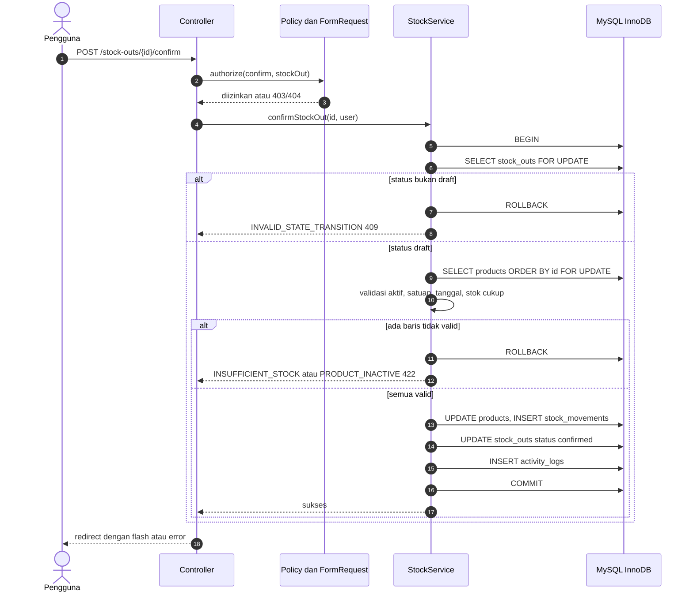

---

## 7. Status dan Transisi

### 7.1 Transaksi barang masuk dan keluar

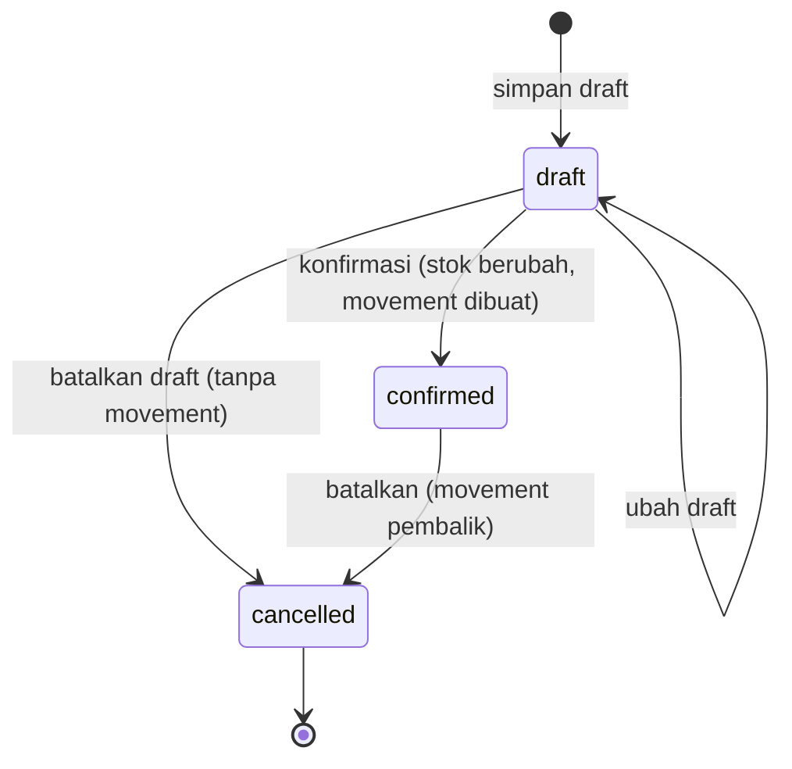

| Dari | Ke | Aktor | Prasyarat | Efek stok | Dicatat |
|---|---|---|---|---|---|
| (baru) | draft | SA, AG, SG | validasi form | tidak ada | `*.draft_created` |
| draft | draft | SA, AG; SG (own) | status masih draft (di-lock) | tidak ada | `*.draft_updated` |
| draft | confirmed | SA, AG; SG (own) | BR-08, BR-10 | ± stok + movement | `*.confirmed` |
| draft | cancelled | pembuat, SA, AG | alasan wajib | tidak ada | `*.draft_cancelled` |
| confirmed | cancelled | SA, AG | alasan wajib; BR-13 | pembalik + movement | `*.cancelled` |
| cancelled | apa pun | — | **dilarang** | — | — |

Setiap transisi tidak sah dijawab `INVALID_STATE_TRANSITION` (HTTP 409). Operasi konfirmasi/pembatalan **idempoten secara aman**: pengulangan pada dokumen yang sudah berubah status menghasilkan 409 tanpa efek samping.

### 7.2 Entitas master (kategori, satuan, supplier, barang) dan pengguna

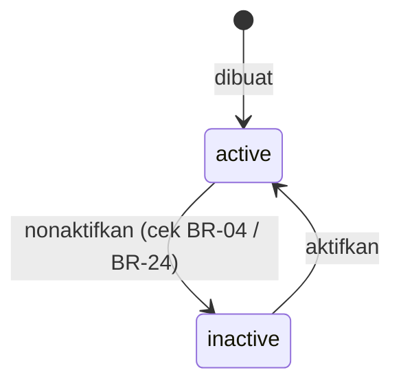

### 7.3 Status stok (turunan, tidak disimpan)

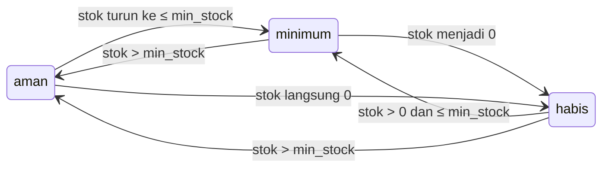

---

## 8. Alur Pengguna (User Flow)

### 8.1 Login dan penegakan akses

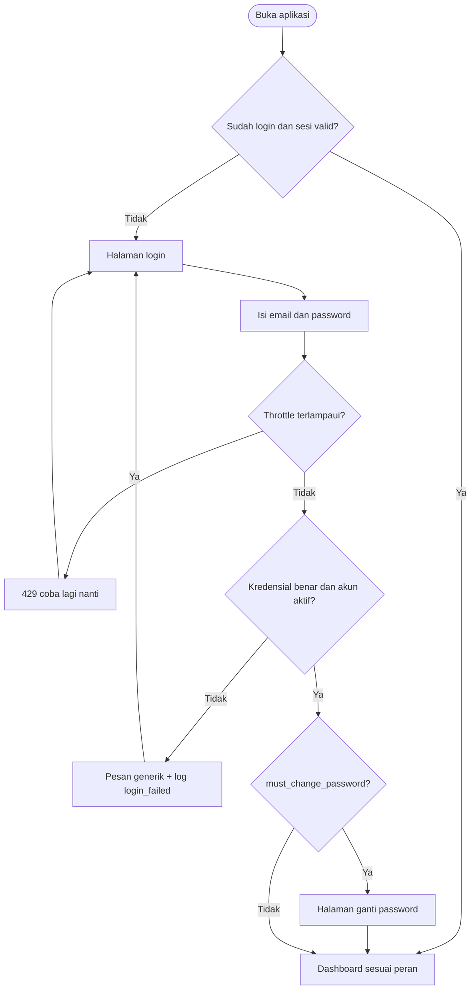

### 8.2 Barang masuk

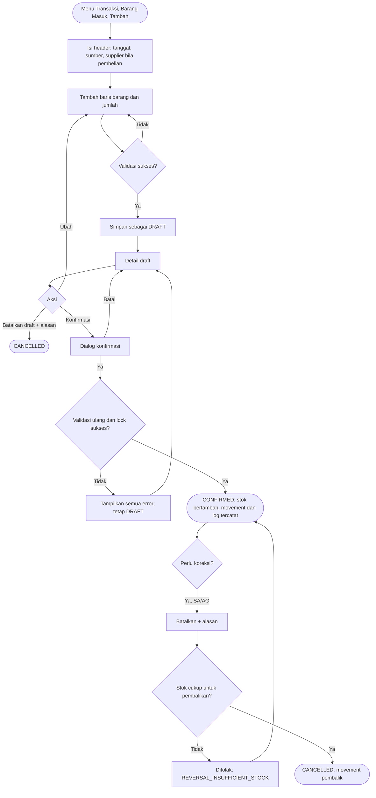

### 8.3 Barang keluar

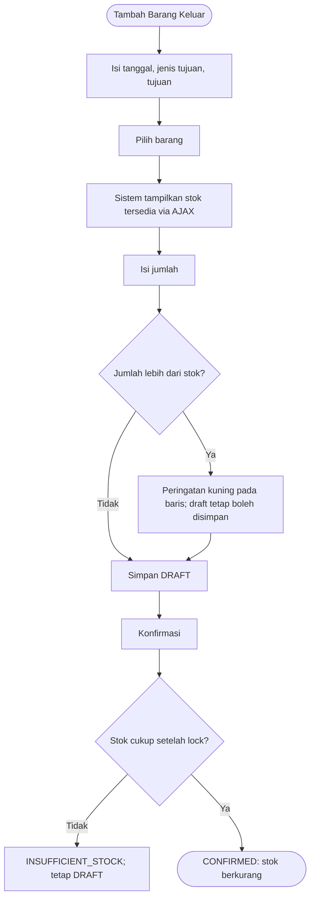

### 8.4 Penyesuaian stok

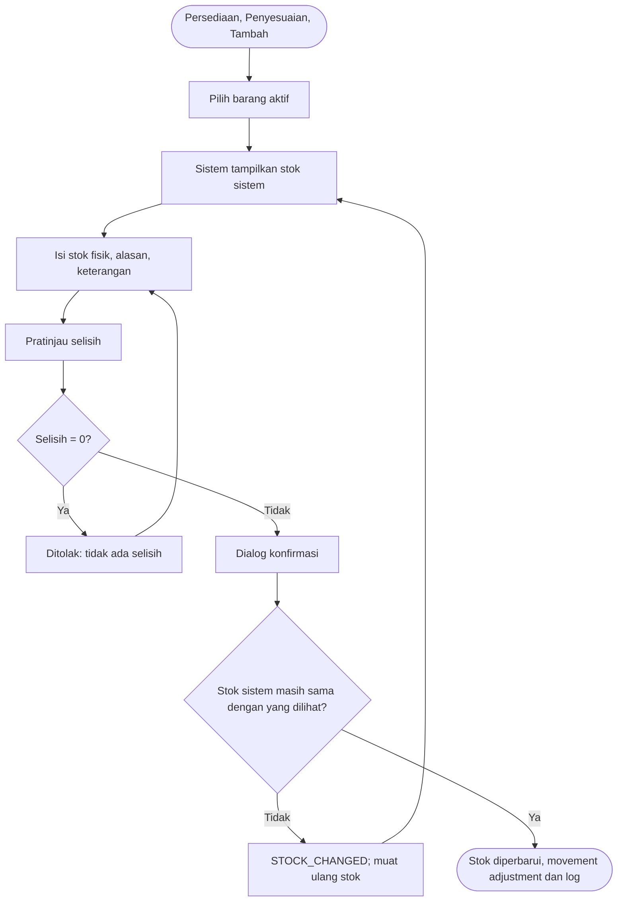

### 8.5 Penambahan barang dengan stok awal

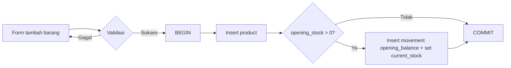

---

## 9. Arsitektur Sistem

### 9.1 Gaya arsitektur `[DITETAPKAN]`

**Monolit Laravel 12 (MVC) server-rendered** dengan Blade + Tailwind + Alpine.js. Logika bisnis ditempatkan di **service layer**, bukan di controller atau model. Tidak ada microservice, queue, atau cache terdistribusi pada MVP (menghindari overengineering). Struktur dipisah agar dapat dikembangkan ke multi-gudang dan queue tanpa menulis ulang.

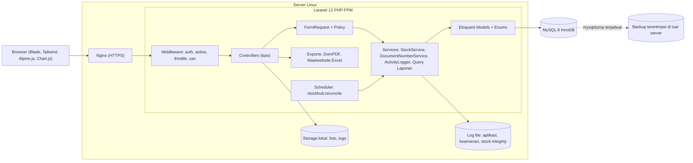

### 9.2 Tanggung jawab lapisan

| Lapisan | Tanggung jawab | Larangan |
|---|---|---|
| Middleware | `auth`, `EnsureUserIsActive`, `EnsurePasswordChanged`, `throttle`, `can:` | Tidak berisi logika bisnis |
| Controller | Menerima request tervalidasi, memanggil service, memilih respons | Tidak menulis stok; tidak query kompleks |
| FormRequest | Validasi sintaks/aturan field, `authorize()` dasar | Tidak mengubah data |
| Policy | Otorisasi tingkat objek: scope own, status dokumen | — |
| Service | Aturan bisnis, DB transaction, locking, penomoran, log | Tidak mengakses `request()` / session |
| Model/Enum | Relasi, cast, scope, `StockStatus`, guard append-only | Tidak berisi alur bisnis |
| Query object laporan | Satu sumber query untuk layar, PDF, Excel (BR-31) | — |

### 9.3 Struktur folder aplikasi

```text
app/
├── Console/Commands/ReconcileStock.php
├── Enums/ (TransactionStatus, MovementType, StockInSource, StockOutPurpose, AdjustmentReason, StockStatus)
├── Exceptions/ (domain exceptions: InsufficientStockException, InvalidStateTransitionException, ...)
├── Exports/ (Excel exports per laporan) 
├── Http/
│   ├── Controllers/ (Auth, Dashboard, Master, Transaction, Inventory, Report, Admin)
│   ├── Middleware/
│   └── Requests/
├── Models/
├── Policies/
├── Reports/ (query object per laporan)
└── Services/ (StockService, StockInService, StockOutService, StockAdjustmentService, ProductService, DocumentNumberService, ActivityLogger)
database/ (migrations, seeders, factories)
resources/views/ (layouts, components, per modul)
tests/ (Unit, Feature, Concurrency)
docs/
```

### 9.4 Keputusan arsitektural penting

| Topik | Keputusan | Alasan |
|---|---|---|
| Saldo stok | `products.current_stock` (cache saldo) + `stock_movements` (sumber kebenaran audit), selalu diperbarui bersamaan | Baca cepat + jejak audit; rekonsiliasi menjaga konsistensi (BR-28) |
| Konkurensi | Pessimistic locking (`FOR UPDATE`) dengan urutan tetap | Sederhana dan benar untuk skala A-04 |
| Isolation level | MySQL default `REPEATABLE READ`; keputusan stok memakai *locking read* sehingga membaca data terbaru | Mencegah lost update |
| Tipe data | `DECIMAL`, bukan `FLOAT`; perhitungan di backend (string/BCMath atau `brick/math` bila perlu) | Presisi |
| Ekspor | Sinkron dengan batas baris; Excel memakai `FromQuery` + chunk | Cukup untuk A-04; queue = pengembangan berikutnya |
| Frontend | Blade + Alpine.js (baris dinamis, dialog) tanpa SPA | Sesuai spesifikasi, perawatan lebih mudah |
| Respons error | Handler terpusat memetakan exception domain → HTTP + kode error (§15) | Perilaku konsisten |
| Multi-gudang | Tidak ada kolom `warehouse_id` sekarang; migrasi didokumentasikan (§18.3) | Hindari overengineering namun jalur jelas |

---

## 10. Tech Stack

| Komponen | Pilihan | Catatan |
|---|---|---|
| Framework backend | Laravel 12.x | Versi dikunci di `composer.lock` |
| Bahasa | PHP 8.2.29 (baseline pengembangan) | Kode tidak boleh memakai fitur PHP ≥ 8.3; lihat R-01 |
| Database | MySQL 8.0.30 (baseline pengembangan), InnoDB, `utf8mb4_unicode_ci` | Skema kompatibel MySQL ≥ 8.0.16 (CHECK constraint) dan 8.4 LTS; lihat R-01 |
| Frontend | Blade, Tailwind CSS (via Vite), Alpine.js 3 | Alpine disertakan starter kit Breeze |
| Autentikasi | Laravel Breeze (stack Blade), registrasi dinonaktifkan | |
| Otorisasi | Spatie Laravel Permission + Laravel Policy | D-03 |
| Grafik | Chart.js 4 | |
| Dialog/notifikasi UI | SweetAlert2 | Dialog konfirmasi transaksi |
| PDF | barryvdh/laravel-dompdf | Alternatif mPDF bila kebutuhan font/layout tidak terpenuhi |
| Excel | maatwebsite/excel 3.1 | Pakai versi terbaru yang kompatibel dengan Laravel 12 (verifikasi saat instalasi) |
| Testing | Pest 3 (PHPUnit di bawahnya) | Pest 4 menuntut PHP ≥ 8.3 sehingga tidak dipakai pada baseline 8.2 |
| Kualitas kode | Laravel Pint (style), Larastan (PHPStan level ≥ 5) | Dijalankan di CI |
| Build aset | Node.js LTS + Vite (hanya saat build/pengembangan) | Tidak perlu Node di server produksi bila build dilakukan di CI |
| Dependency manager | Composer 2, npm | Audit: `composer audit`, `npm audit` |
| Lingkungan dev | Laragon (Windows) | Hanya untuk lokal |
| Lingkungan prod | Linux (Ubuntu LTS), Nginx, PHP-FPM, MySQL, cron | A-05 |
| Sesi/cache | Driver `database` | A-08 |
| Queue | Tidak dipakai pada MVP (`sync`) | A-07 |

Tidak digunakan: AI/ML, payment gateway, layanan pesan eksternal, SPA framework `[DITETAPKAN]`.

---

## 11. Skema Database

### 11.1 Ketentuan umum `[DITETAPKAN]`

- Engine InnoDB, charset `utf8mb4`, collation `utf8mb4_unicode_ci` (perbandingan unik case-insensitive).
- PK `BIGINT UNSIGNED AUTO_INCREMENT` bernama `id`. Semua FK dideklarasikan eksplisit dengan `ON DELETE RESTRICT` (tidak ada penghapusan pada MVP, BR-03).
- Kuantitas `DECIMAL(15,3)`, uang `DECIMAL(15,2)`. Enum disimpan sebagai `VARCHAR` dengan CHECK/Enum PHP (menghindari `ALTER` mahal saat menambah nilai); di tabel di bawah ditulis sebagai `enum(...)` untuk kejelasan.
- CHECK constraint (MySQL ≥ 8.0.16) untuk invarian angka.
- Kolom `created_at`/`updated_at` pada semua tabel kecuali yang ditandai *append-only* (`created_at` saja).
- Nama tabel jamak, snake_case, bahasa Inggris.

### 11.2 ERD

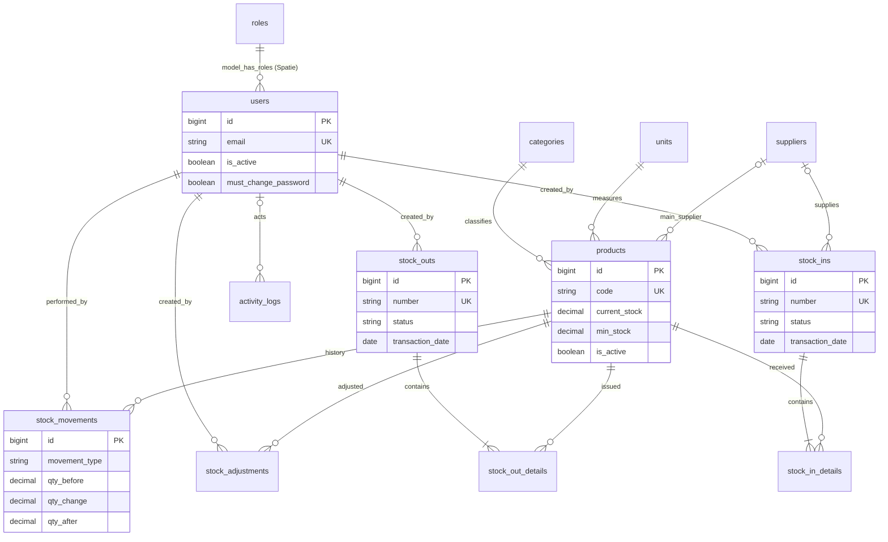

### 11.3 Definisi tabel

#### `users`

| Kolom | Tipe | Constraint |
|---|---|---|
| id | bigint unsigned | PK |
| name | varchar(100) | NOT NULL |
| email | varchar(150) | NOT NULL, UNIQUE |
| password | varchar(255) | NOT NULL (hash bcrypt) |
| is_active | boolean | NOT NULL, default 1 |
| must_change_password | boolean | NOT NULL, default 0 |
| last_login_at | datetime | NULL |
| last_login_ip | varchar(45) | NULL |
| remember_token | varchar(100) | NULL (tidak dipakai) |
| created_at, updated_at | timestamp | |

Index: `UNIQUE(email)`, `INDEX(is_active)`. Peran lewat tabel Spatie `model_has_roles`; `roles` di-seed: `super_admin`, `admin_gudang`, `staff_gudang`, `manajer`.

#### `categories`

| Kolom | Tipe | Constraint |
|---|---|---|
| id | bigint unsigned | PK |
| name | varchar(100) | NOT NULL, UNIQUE |
| description | varchar(500) | NULL |
| is_active | boolean | NOT NULL, default 1 |
| created_at, updated_at | timestamp | |

#### `units`

| Kolom | Tipe | Constraint |
|---|---|---|
| id | bigint unsigned | PK |
| name | varchar(50) | NOT NULL, UNIQUE |
| symbol | varchar(10) | NOT NULL, UNIQUE |
| description | varchar(255) | NULL |
| allow_decimal | boolean | NOT NULL, default 0 |
| is_active | boolean | NOT NULL, default 1 |
| created_at, updated_at | timestamp | |

#### `suppliers`

| Kolom | Tipe | Constraint |
|---|---|---|
| id | bigint unsigned | PK |
| code | varchar(20) | NOT NULL, UNIQUE |
| name | varchar(150) | NOT NULL |
| contact_name | varchar(100) | NULL |
| phone | varchar(30) | NULL |
| email | varchar(150) | NULL |
| address | text | NULL |
| notes | text | NULL |
| is_active | boolean | NOT NULL, default 1 |
| created_at, updated_at | timestamp | |

Index: `INDEX(name)`, `INDEX(is_active)`.

#### `products`

| Kolom | Tipe | Constraint |
|---|---|---|
| id | bigint unsigned | PK |
| code | varchar(30) | NOT NULL, UNIQUE |
| name | varchar(150) | NOT NULL |
| category_id | bigint unsigned | NOT NULL, FK → categories.id |
| unit_id | bigint unsigned | NOT NULL, FK → units.id |
| main_supplier_id | bigint unsigned | NULL, FK → suppliers.id |
| purchase_price | decimal(15,2) | NOT NULL, default 0, CHECK ≥ 0 |
| selling_price | decimal(15,2) | NULL, CHECK ≥ 0 |
| current_stock | decimal(15,3) | NOT NULL, default 0, **CHECK ≥ 0** |
| min_stock | decimal(15,3) | NOT NULL, default 0, CHECK ≥ 0 |
| storage_location | varchar(100) | NULL |
| description | text | NULL |
| photo_path | varchar(255) | NULL |
| is_active | boolean | NOT NULL, default 1 |
| created_by, updated_by | bigint unsigned | NULL, FK → users.id |
| created_at, updated_at | timestamp | |

Index: `UNIQUE(code)`, `INDEX(name)`, `INDEX(category_id, is_active)`, `INDEX(is_active, current_stock)`, FK index otomatis. Pencarian memakai `LIKE`; cukup untuk A-04 (FULLTEXT = opsi bila lambat).

#### `stock_ins`

| Kolom | Tipe | Constraint |
|---|---|---|
| id | bigint unsigned | PK |
| number | varchar(30) | NOT NULL, UNIQUE |
| transaction_date | date | NOT NULL |
| source_type | enum('purchase','internal','return','other') | NOT NULL |
| supplier_id | bigint unsigned | NULL, FK → suppliers.id |
| reference_document | varchar(100) | NULL |
| notes | text | NULL |
| status | enum('draft','confirmed','cancelled') | NOT NULL, default 'draft' |
| total_amount | decimal(15,2) | NOT NULL, default 0 |
| created_by | bigint unsigned | NOT NULL, FK → users.id |
| confirmed_by, cancelled_by | bigint unsigned | NULL, FK → users.id |
| confirmed_at, cancelled_at | datetime | NULL |
| cancel_reason | varchar(255) | NULL |
| created_at, updated_at | timestamp | |

CHECK: `source_type <> 'purchase' OR supplier_id IS NOT NULL`. Index: `INDEX(status, transaction_date)`, `INDEX(supplier_id)`, `INDEX(created_by, status)`.

#### `stock_in_details`

| Kolom | Tipe | Constraint |
|---|---|---|
| id | bigint unsigned | PK |
| stock_in_id | bigint unsigned | NOT NULL, FK → stock_ins.id |
| product_id | bigint unsigned | NOT NULL, FK → products.id |
| quantity | decimal(15,3) | NOT NULL, **CHECK > 0** |
| unit_price | decimal(15,2) | NOT NULL, default 0, CHECK ≥ 0 |
| created_at, updated_at | timestamp | |

Constraint: `UNIQUE(stock_in_id, product_id)`; `INDEX(product_id)`.

#### `stock_outs`

Struktur kolom sama dengan `stock_ins` dengan perbedaan: tidak ada `supplier_id`, `reference_document`, `total_amount`; ditambah `purpose_type enum('usage','sale','shipment','transfer_to_party','other') NOT NULL` dan `destination varchar(150) NOT NULL`. Index: `INDEX(status, transaction_date)`, `INDEX(created_by, status)`, `UNIQUE(number)`.

#### `stock_out_details`

`id`, `stock_out_id` (FK), `product_id` (FK), `quantity decimal(15,3) CHECK > 0`, timestamps. `UNIQUE(stock_out_id, product_id)`, `INDEX(product_id)`.

#### `stock_adjustments`

| Kolom | Tipe | Constraint |
|---|---|---|
| id | bigint unsigned | PK |
| number | varchar(30) | NOT NULL, UNIQUE |
| adjustment_date | date | NOT NULL |
| product_id | bigint unsigned | NOT NULL, FK → products.id |
| system_qty | decimal(15,3) | NOT NULL, CHECK ≥ 0 |
| physical_qty | decimal(15,3) | NOT NULL, CHECK ≥ 0 |
| difference | decimal(15,3) | NOT NULL, CHECK ≠ 0, harus = physical_qty − system_qty |
| reason_code | enum('damaged','lost','recording_error','count_error','expired','found','other') | NOT NULL |
| notes | text | NOT NULL |
| created_by | bigint unsigned | NOT NULL, FK → users.id |
| created_at, updated_at | timestamp | |

Index: `INDEX(adjustment_date)`, `INDEX(product_id, adjustment_date)`, `INDEX(created_by)`. Tidak ada kolom status (final).

#### `stock_movements` *(append-only)*

| Kolom | Tipe | Constraint |
|---|---|---|
| id | bigint unsigned | PK (urutan posting) |
| product_id | bigint unsigned | NOT NULL, FK → products.id |
| movement_type | enum('opening_balance','stock_in','stock_out','adjustment','stock_in_cancel','stock_out_cancel') | NOT NULL |
| reference_type | varchar(30) | NULL (`product`, `stock_in`, `stock_out`, `stock_adjustment`) |
| reference_id | bigint unsigned | NULL |
| reference_number | varchar(30) | NULL (denormalisasi untuk tampilan) |
| movement_date | date | NOT NULL (= tanggal bisnis dokumen) |
| qty_before | decimal(15,3) | NOT NULL, CHECK ≥ 0 |
| qty_change | decimal(15,3) | NOT NULL, CHECK ≠ 0 (bertanda) |
| qty_after | decimal(15,3) | NOT NULL, CHECK ≥ 0, CHECK = qty_before + qty_change |
| user_id | bigint unsigned | NOT NULL, FK → users.id |
| notes | varchar(255) | NULL |
| created_at | timestamp | NOT NULL |

Index: `INDEX(product_id, id)`, `INDEX(movement_date)`, `INDEX(movement_type, movement_date)`, `INDEX(reference_type, reference_id)`, `INDEX(user_id)`.

Pemetaan tanda: `opening_balance` +, `stock_in` +, `stock_out` −, `adjustment` ±, `stock_in_cancel` −, `stock_out_cancel` +.

#### `activity_logs` *(append-only)*

| Kolom | Tipe | Constraint |
|---|---|---|
| id | bigint unsigned | PK |
| user_id | bigint unsigned | NULL, FK → users.id (NULL untuk login gagal/sistem) |
| action | varchar(60) | NOT NULL (mis. `stock_out.confirmed`) |
| description | varchar(255) | NOT NULL |
| subject_type | varchar(30) | NULL |
| subject_id | bigint unsigned | NULL |
| old_values, new_values | json | NULL (tanpa data rahasia) |
| ip_address | varchar(45) | NULL |
| user_agent | varchar(255) | NULL |
| created_at | timestamp | NOT NULL |

Index: `INDEX(user_id, created_at)`, `INDEX(action, created_at)`, `INDEX(subject_type, subject_id)`, `INDEX(created_at)`.

#### `document_sequences`

| Kolom | Tipe | Constraint |
|---|---|---|
| id | bigint unsigned | PK |
| sequence_key | varchar(40) | NOT NULL, UNIQUE (`IN-202611`, `OUT-202611`, `ADJ-202611`, `BRG`, `SUP`) |
| last_number | int unsigned | NOT NULL, default 0 |
| created_at, updated_at | timestamp | |

#### `settings`

| Kolom | Tipe | Constraint |
|---|---|---|
| key | varchar(100) | PK |
| value | text | NULL |
| updated_by | bigint unsigned | NULL, FK → users.id |
| updated_at | timestamp | |

Kunci: `company_name`, `company_address`, `company_phone`, `company_logo_path`, `max_backdate_days`.

#### Tabel framework dan paket

`sessions`, `cache`, `cache_locks`, `password_reset_tokens` (belum dipakai), `migrations`, serta tabel Spatie (`roles`, `permissions`, `model_has_roles`, `model_has_permissions`, `role_has_permissions`).

### 11.4 Strategi migration dan seeding

1. Satu migration per tabel, urut sesuai ketergantungan FK; nama deskriptif (`create_products_table`).
2. Migration yang sudah dirilis **tidak diedit**; perubahan = migration baru. Perubahan bersifat *expand/contract* (tambah kolom nullable → backfill → perketat) agar deploy aman (§17).
3. Setiap migration wajib dapat dijalankan pada database kosong dan pada database dari rilis sebelumnya (diuji di CI).
4. `down()` ditulis untuk lingkungan dev; rollback produksi bertumpu pada backup (§17.5).
5. Seeder produksi (idempoten): `RoleAndPermissionSeeder` (peran + izin §4.2), `UnitSeeder`, `SettingSeeder` (nilai default), `InitialSuperAdminSeeder` (membaca email dari env `INITIAL_ADMIN_EMAIL`; password acak sekali pakai ditampilkan di console, `must_change_password = true`; tidak ada password di repositori).
6. Seeder data contoh/uji (`DemoSeeder`) hanya untuk `local`/`testing`; tidak pernah dijalankan di produksi.

---

## 12. Spesifikasi Endpoint dan API

### 12.1 Pendekatan `[DITETAPKAN]`

StockHub adalah aplikasi **server-rendered berbasis sesi**. Tidak ada REST API publik/token pada MVP. Antarmuka HTTP terdiri dari:

1. **Route web** (HTML, sesi + CSRF) — form dan halaman.
2. **Endpoint AJAX JSON** (`/ajax/*`) — pencarian barang, stok, data grafik; sesi + otorisasi yang sama.

API terbuka untuk integrasi pihak ketiga (Sanctum/token) = `[DIRENCANAKAN]`.

**Konvensi umum**

| Aspek | Ketentuan |
|---|---|
| Autentikasi | Cookie sesi; semua route kecuali `/login` dan `/up` mensyaratkan `auth` |
| CSRF | Semua method non-GET membutuhkan token CSRF (`_token` atau header `X-CSRF-TOKEN`) |
| Method override | `PUT`/`PATCH` via `_method` pada form |
| Negosiasi respons | Request HTML → redirect + flash/`errors`; request `Accept: application/json` atau AJAX → JSON |
| Pagination | Query `?page=` dan `?per_page=` (15/25/50/100) |
| Format tanggal | `YYYY-MM-DD` pada input; tampilan `DD/MM/YYYY` |
| Format angka | Kuantitas dan uang dikirim sebagai string desimal bertitik (`"12.500"`), bukan format lokal |
| Kode error | Lihat §15 |

**Amplop JSON error**

```json
{
  "message": "Persediaan tidak mencukupi.",
  "code": "INSUFFICIENT_STOCK",
  "errors": {
    "items.0.quantity": ["Stok Mouse Logitech tersisa 5 pcs, diminta 7 pcs."]
  }
}
```

### 12.2 Route web

Akses menyingkat peran yang diizinkan; "own" = SG hanya miliknya. Semua route juga membutuhkan sesi login aktif dan password tidak berstatus wajib-ganti.

| Method | Path | Fungsi | Permission | Peran |
|---|---|---|---|---|
| GET | `/login` | Form login | publik | — |
| POST | `/login` | Proses login (throttle 5/menit) | publik | — |
| POST | `/logout` | Logout | auth | semua |
| GET/PUT | `/password/change` | Ganti password wajib | auth | semua |
| GET/PATCH | `/profile` | Lihat/ubah profil | auth | semua |
| PUT | `/profile/password` | Ganti password sendiri | auth | semua |
| GET | `/` | Redirect ke `/dashboard` | auth | semua |
| GET | `/dashboard` | Dashboard | `dashboard.view` | semua |
| GET | `/users`, `/users/create`, `/users/{user}`, `/users/{user}/edit` | Daftar, form, detail | `users.manage` | SA |
| POST | `/users` | Tambah pengguna | `users.manage` | SA |
| PUT | `/users/{user}` | Ubah pengguna | `users.manage` | SA |
| PATCH | `/users/{user}/status` | Aktif/nonaktif | `users.manage` | SA |
| POST | `/users/{user}/reset-password` | Reset password | `users.manage` | SA |
| GET | `/roles` | Matriks peran (read-only) | `roles.view` | SA |
| GET | `/categories` (+`/create`, `/{id}/edit`) | Daftar/form | `categories.view` / `.manage` | view: semua; manage: SA, AG |
| POST/PUT/PATCH | `/categories`, `/categories/{id}`, `/categories/{id}/status` | Simpan/ubah/status | `categories.manage` | SA, AG |
| GET / POST / PUT / PATCH | `/units…` | Pola sama dengan kategori | `units.*` | view: semua; manage: SA, AG |
| GET | `/suppliers`, `/suppliers/{id}` | Daftar/detail | `suppliers.view` | semua |
| GET/POST/PUT/PATCH | `/suppliers/create`, `/suppliers`, `/suppliers/{id}/edit`, `/suppliers/{id}`, `/suppliers/{id}/status` | Form/simpan/ubah/status | `suppliers.manage` | SA, AG |
| GET | `/products`, `/products/{id}` | Daftar/detail + kartu stok | `products.view` | semua |
| GET/POST/PUT/PATCH | `/products/create`, `/products`, `/products/{id}/edit`, `/products/{id}`, `/products/{id}/status` | Form/simpan/ubah/status | `products.manage` | SA, AG |
| GET | `/stock-ins`, `/stock-ins/{id}` | Daftar/detail | `stock-ins.view` | SA, AG, MG; SG own |
| GET | `/stock-ins/create`, `/stock-ins/{id}/edit` | Form (edit hanya draft) | `stock-ins.create` | SA, AG; SG own |
| POST | `/stock-ins` | Simpan draft | `stock-ins.create` | SA, AG, SG |
| PUT | `/stock-ins/{id}` | Ubah draft | `stock-ins.create` | SA, AG; SG own |
| POST | `/stock-ins/{id}/confirm` | Konfirmasi | `stock-ins.create` | SA, AG; SG own |
| POST | `/stock-ins/{id}/cancel` | Batalkan (draft: pembuat/SA/AG; confirmed: SA/AG) | `stock-ins.create` / `.cancel-confirmed` | sesuai status |
| GET/POST/PUT | `/stock-outs…`, `/stock-outs/{id}/confirm`, `/stock-outs/{id}/cancel` | Pola sama dengan barang masuk | `stock-outs.*` | sama |
| GET | `/adjustments`, `/adjustments/{id}` | Daftar/detail | `adjustments.view` | SA, AG, MG |
| GET/POST | `/adjustments/create`, `/adjustments` | Form/posting | `adjustments.create` | SA, AG |
| GET | `/stocks` | Stok barang | `stocks.view` | semua |
| GET | `/stocks/low` | Stok minimum | `stocks.view` | semua |
| GET | `/stock-movements` | Riwayat stok | `stock-movements.view` | SA, AG, MG |
| GET | `/reports/{type}` | Laporan `stock`, `stock-ins`, `stock-outs`, `adjustments`, `movements` | `reports.view` | SA, AG, MG |
| GET | `/reports/{type}/export/{format}` | Ekspor `pdf` / `xlsx` (query = filter layar; throttle 10/menit/pengguna) | `reports.export` | SA, AG, MG |
| GET | `/activity-logs` | Log aktivitas | `activity-logs.view` | SA |
| GET/PUT | `/settings` | Pengaturan sistem | `settings.manage` | SA |
| GET | `/up` | Health check (tanpa data sensitif) | publik | — |

Tidak ada route `DELETE` untuk entitas bisnis (BR-03, BR-12).

### 12.3 Endpoint AJAX JSON

| Method | Path | Tujuan | Permission |
|---|---|---|---|
| GET | `/ajax/products/search?q=&context=stock_in\|stock_out\|adjustment&limit=20` | Pencarian barang untuk dropdown baris (hanya barang aktif) | `products.view` |
| GET | `/ajax/products/{id}/stock` | Stok terkini, stok minimum, status untuk satu barang | `products.view` |
| GET | `/ajax/dashboard/chart?period=daily\|weekly\|monthly` | Data grafik transaksi masuk vs keluar | `dashboard.view` (SG: 403) |

**`GET /ajax/products/search?q=mou&context=stock_out`** — 200

```json
{
  "data": [
    {
      "id": 12,
      "code": "BRG-0012",
      "name": "Mouse Logitech M185",
      "unit": { "symbol": "pcs", "allow_decimal": false },
      "current_stock": "10.000",
      "stock_status": "aman",
      "purchase_price": "85000.00"
    }
  ]
}
```

`purchase_price` hanya ada bila pengguna memiliki `products.view-price`. Untuk `context=stock_out` hasil tetap memuat barang berstok 0 (ditandai habis) agar pengguna memahami alasan penolakan.

**`GET /ajax/products/12/stock`** — 200

```json
{ "id": 12, "current_stock": "10.000", "min_stock": "5.000", "stock_status": "aman", "unit": { "symbol": "pcs", "allow_decimal": false } }
```

**`GET /ajax/dashboard/chart?period=daily`** — 200

```json
{
  "period": "daily",
  "labels": ["2026-10-24", "2026-10-25"],
  "series": [
    { "name": "Barang Masuk", "data": [3, 1] },
    { "name": "Barang Keluar", "data": [5, 2] }
  ],
  "unit": "transaksi"
}
```

### 12.4 Kontrak operasi inti (form POST)

**`POST /stock-outs`** (simpan draft) — field

| Field | Tipe | Wajib | Catatan |
|---|---|:-:|---|
| `transaction_date` | date | ✔ | BR-20 |
| `purpose_type` | string | ✔ | `usage\|sale\|shipment\|transfer_to_party\|other` |
| `destination` | string | ✔ | 3–150 |
| `notes` | string | – | ≤ 1000 |
| `items[n][product_id]` | int | ✔ | aktif, unik |
| `items[n][quantity]` | decimal-string | ✔ | > 0, aturan satuan |

Respons: HTML → 302 ke `/stock-outs/{id}` dengan flash sukses; JSON → 201

```json
{ "data": { "id": 41, "number": "OUT-202611-0007", "status": "draft" } }
```

Gagal validasi: HTML → kembali ke form + `errors` + `old()`; JSON → 422 (amplop §12.1, kode `VALIDATION_FAILED`).

**`POST /stock-outs/{id}/confirm`** (tanpa body selain CSRF)

| Hasil | HTTP | Kode | Efek |
|---|---|---|---|
| Sukses | 302 / 200 | — | stok berkurang, movement, status `confirmed` |
| Stok kurang | 422 | `INSUFFICIENT_STOCK` | tidak ada perubahan |
| Barang nonaktif | 422 | `PRODUCT_INACTIVE` | tidak ada perubahan |
| Status bukan draft | 409 | `INVALID_STATE_TRANSITION` | tidak ada perubahan |
| Bukan pemilik (SG) | 404 | `NOT_FOUND` | — |
| Tanpa izin | 403 | `FORBIDDEN` | — |
| Lock gagal setelah retry | 503 | `LOCK_TIMEOUT` | tidak ada perubahan |

Sukses JSON (200):

```json
{ "data": { "id": 41, "number": "OUT-202611-0007", "status": "confirmed", "confirmed_at": "2026-11-06T10:15:02+07:00" } }
```

**`POST /stock-ins/{id}/cancel`** — body `reason` (wajib, 10–255). Kode khusus: `REVERSAL_INSUFFICIENT_STOCK` (422).

**`POST /adjustments`** — field `adjustment_date`, `product_id`, `expected_system_qty`, `physical_qty`, `reason_code`, `notes`. Kode khusus: `STOCK_CHANGED` (409), `NO_DIFFERENCE` (422).

**`GET /reports/stock-ins/export/xlsx?date_from=2026-11-01&date_to=2026-11-30&supplier_id=3`** — 200 `application/vnd.openxmlformats-officedocument.spreadsheetml.sheet` dengan `Content-Disposition: attachment`; `EXPORT_LIMIT_EXCEEDED` (422) bila melebihi batas.

---

## 13. Kebutuhan UI/UX

### 13.1 Layout dan navigasi `[DITETAPKAN]`

Layout: **sidebar** (navigasi utama), **navbar atas** (judul halaman, lonceng stok minimum, menu akun), **area konten**. Pada layar < 1024 px sidebar menjadi drawer yang dibuka tombol hamburger.

| Menu | Submenu | SA | AG | SG | MG |
|---|---|:-:|:-:|:-:|:-:|
| Dashboard | Ringkasan | ✔ | ✔ | ✔ | ✔ |
| Master Data | Barang, Kategori, Satuan, Supplier | ✔ (kelola) | ✔ (kelola) | lihat Barang, Kategori, Satuan, Supplier | lihat |
| Transaksi | Barang Masuk, Barang Keluar | ✔ | ✔ | ✔ (milik sendiri) | lihat |
| Persediaan | Stok Barang, Stok Minimum, Penyesuaian, Riwayat Stok | ✔ | ✔ | Stok Barang, Stok Minimum | Stok Barang, Stok Minimum, Penyesuaian (lihat), Riwayat Stok |
| Laporan | Stok, Barang Masuk, Barang Keluar, Penyesuaian, Pergerakan Stok | ✔ | ✔ | – | ✔ |
| Pengguna | Data Pengguna, Peran dan Hak Akses | ✔ | – | – | – |
| Aktivitas | Log Aktivitas | ✔ | – | – | – |
| Pengaturan | Profil (semua); Pengaturan Sistem (SA) | ✔ | Profil | Profil | Profil |

Menu/submenu yang tidak berhak **tidak dirender**; sub-menu multi-gudang (Gudang, Perpindahan Stok) tidak ditampilkan pada MVP.

### 13.2 Standar komponen

| Komponen | Persyaratan |
|---|---|
| Palet | Biru primer (aksi utama, link, item aktif); abu-abu untuk latar/netral; hijau = stok aman, kuning/amber = stok minimum, merah = stok habis/aksi destruktif |
| Badge status stok | Warna **dan** teks + ikon (tidak hanya warna): "Aman", "Minimum", "Habis" |
| Badge status transaksi | Draft (abu-abu), Confirmed (hijau), Cancelled (merah) dengan teks |
| Tabel data | Pencarian, filter, sort, pagination, state kosong ("Belum ada data" + aksi), state loading; aksi baris sesuai izin |
| Form | Label terlihat, penanda wajib, validasi sisi server dengan pesan per field (tampil di dekat field + ringkasan di atas), nilai lama dipertahankan (`old()`), tombol submit dinonaktifkan sesudah klik (cegah klik ganda) |
| Form transaksi | Baris dinamis (Alpine.js): tambah/hapus baris, pencarian barang (AJAX), satuan dan stok tersedia otomatis, peringatan stok (barang keluar), pratinjau subtotal (barang masuk, hanya peran berhak harga), cegah barang ganda |
| Dialog konfirmasi | Wajib untuk: konfirmasi transaksi, pembatalan, penyesuaian, aktif/nonaktif, reset password. Menyebut ringkasan efek ("Stok Mouse akan berkurang 5 pcs") dan memiliki tombol Batal sebagai default fokus |
| Notifikasi | Toast sukses/gagal (SweetAlert2/komponen Blade); error blok untuk kegagalan transaksi (daftar per baris) |
| Format | Tanggal `DD/MM/YYYY`; angka format Indonesia (`1.250,5`); mata uang `Rp 85.000`; kuantitas menampilkan desimal hanya bila satuan `allow_decimal` |
| Bahasa UI | Indonesia |

### 13.3 Halaman utama dan elemen wajib

| Halaman | Elemen wajib |
|---|---|
| Login | Email, password, pesan error generik, hitung mundur throttle |
| Dashboard | Kartu (FR-DSH-01), grafik + pemilih periode, tabel transaksi terbaru, daftar stok kritis |
| Daftar (semua master/transaksi) | Bar filter, tabel, pagination, tombol tambah (sesuai izin) |
| Form barang | Seluruh field §5.7, pratinjau foto, field stok awal (hanya mode tambah) |
| Detail barang | Data, badge stok, kartu stok 20 movement terakhir dengan tautan dokumen |
| Form barang masuk/keluar | Header + tabel baris; tombol: Simpan Draft, Konfirmasi (dari halaman detail) |
| Detail transaksi | Header, detail, status, riwayat pelaku, tautan movement; tombol sesuai status dan izin |
| Form penyesuaian | Pilih barang → stok sistem → stok fisik → selisih real-time (warna + tanda) → alasan → keterangan |
| Stok Minimum | Kolom §5.11, filter kategori/status, pencarian |
| Laporan | Filter, tabel hasil, tombol Ekspor PDF/Excel, keterangan periode |
| Log aktivitas | Filter, tabel, detail nilai sebelum/sesudah |

### 13.4 Responsivitas dan aksesibilitas

| ID | Requirement |
|---|---|
| NFR-UI-01 | Berfungsi pada lebar 360 px s.d. desktop; tabel lebar discroll horizontal dalam kontainernya, tanpa scroll horizontal halaman |
| NFR-UI-02 | Target aksesibilitas **WCAG 2.1 level AA** untuk alur inti (login, transaksi, penyesuaian) |
| NFR-UI-03 | Seluruh fungsi dapat dioperasikan dengan keyboard; fokus terlihat; urutan tab logis; dialog menjebak fokus dan menutup dengan `Esc` |
| NFR-UI-04 | Kontras teks ≥ 4,5:1 (teks normal); informasi tidak hanya disampaikan lewat warna |
| NFR-UI-05 | Setiap input memiliki `<label>`; pesan error dihubungkan `aria-describedby` dan diumumkan (`aria-live`) |
| NFR-UI-06 | Target sentuh ≥ 44×44 px pada mobile; ukuran font dasar ≥ 16 px |
| NFR-UI-07 | Halaman error (403, 404, 419, 429, 500, 503) bergaya konsisten dengan pesan berbahasa Indonesia dan tautan kembali |

| AC | Terkait | Given / When / Then |
|---|---|---|
| AC-UI-01 | NFR-UI-01 | Given viewport 360 px, When membuka form barang keluar dengan 5 baris, Then semua kontrol dapat dipakai tanpa scroll horizontal halaman |
| AC-UI-02 | NFR-UI-03 | Given pengguna hanya memakai keyboard, When mencatat dan mengonfirmasi barang keluar, Then seluruh langkah dapat diselesaikan |
| AC-UI-03 | NFR-UI-04 | Given badge stok, When diperiksa pembaca layar / tampilan grayscale, Then status tetap terbaca dari teks |
| AC-UI-04 | §13.2 | Given pengguna menekan Konfirmasi dua kali cepat, When request dikirim, Then tombol sudah nonaktif setelah klik pertama (dan backend tetap aman, AC-STI-07) |

---

## 14. Kebutuhan Non-Fungsional dan Keamanan

### 14.1 Keamanan

Baseline: **OWASP ASVS level 1** dan OWASP Top 10 sebagai daftar periksa review.

| ID | Requirement | Verifikasi |
|---|---|---|
| SEC-01 | Password di-hash (bcrypt, cost ≥ 12); aturan password §5.1; tidak pernah dicatat/ditampilkan | TC-SEC-01 |
| SEC-02 | Pembatasan login 5/menit per email+IP; throttle ekspor 10/menit/pengguna; throttle umum 120 request/menit/pengguna | TC-AUTH-03 |
| SEC-03 | Proteksi CSRF pada semua request non-GET; cookie sesi `HttpOnly`, `Secure` (produksi), `SameSite=Lax`; regenerasi sesi saat login; sesi idle 120 menit | TC-SEC-02 |
| SEC-04 | Otorisasi backend pada **setiap** route (middleware `can:` + Policy); IDOR scope own → 404; pengujian otomatis menelusuri semua route terhadap semua peran | TC-AUTHZ-01..05 |
| SEC-05 | Validasi input di backend dengan FormRequest; mass assignment dilindungi (`$fillable`, tanpa `$guarded = []`); field terlarang (`current_stock`, `code` saat ubah, `status`) tidak pernah diterima dari form umum | TC-SEC-03 |
| SEC-06 | Pencegahan SQL injection: hanya Eloquent/query builder berparameter; tanpa `DB::raw` dengan input pengguna | Code review, Larastan |
| SEC-07 | Pencegahan XSS: output Blade ter-escape (`{{ }}`); `{!! !!}` dilarang untuk data pengguna; Content-Security-Policy dasar; template PDF juga meng-escape | TC-SEC-04 |
| SEC-08 | Unggahan file: validasi MIME sebenarnya + ekstensi + ukuran + dimensi; nama acak; disimpan di luar web root yang dapat dieksekusi (`storage/app/public`, tanpa eksekusi PHP); tidak menerima SVG | TC-SEC-05 |
| SEC-09 | Header keamanan: `X-Content-Type-Options: nosniff`, `X-Frame-Options: DENY` (atau CSP `frame-ancestors`), `Referrer-Policy: strict-origin-when-cross-origin`, HSTS di produksi | Pemeriksaan deployment |
| SEC-10 | Ekspor Excel/CSV mencegah *formula injection*: sel teks diawali `=`, `+`, `-`, `@`, tab, atau CR diberi prefiks `'` | TC-SEC-06 |
| SEC-11 | Pesan error tidak membocorkan informasi sensitif (stack trace, query, path); `APP_DEBUG=false` di produksi | TC-ERR-05 |
| SEC-12 | Rahasia (APP_KEY, kredensial DB, dsb.) hanya di variabel lingkungan; `.env` tidak masuk repositori; `.env.example` hanya berisi placeholder | Pemeriksaan CI (secret scan) |
| SEC-13 | Hak minimum akun database: akun aplikasi hanya `SELECT, INSERT, UPDATE, DELETE` pada skema aplikasi; (hardening) tanpa `UPDATE/DELETE` pada `stock_movements` dan `activity_logs`; akun migration terpisah | Pemeriksaan deployment |
| SEC-14 | Dependensi dipindai: `composer audit` dan `npm audit` di CI; pembaruan keamanan diprioritaskan | CI |
| SEC-15 | Enumerasi akun dicegah: pesan login generik; respons reset password tidak membocorkan keberadaan email (tidak relevan MVP karena tidak ada forgot-password) | AC-AUTH-02 |
| SEC-16 | Log aktivitas dan log keamanan tidak berisi password/token/APP_KEY | AC-LOG-02 |
| SEC-17 | Backup database dienkripsi saat disimpan di luar server | Pemeriksaan deployment |

### 14.2 Integritas data

| ID | Requirement |
|---|---|
| NFR-INT-01 | Semua perubahan stok atomik (BR-08) dan terkunci (BR-09) |
| NFR-INT-02 | Constraint database (CHECK, UNIQUE, FK) sebagai lapis pertahanan kedua selain validasi aplikasi |
| NFR-INT-03 | Rekonsiliasi harian (FR-SYS-01) dengan hasil terdokumentasi |
| NFR-INT-04 | `stock_movements` dan `activity_logs` append-only (BR-15) |
| NFR-INT-05 | Tidak ada eksekusi pembaruan stok di luar `StockService` (dijaga oleh code review + test arsitektur yang memeriksa `current_stock` hanya ditulis di service) |

### 14.3 Performa dan skalabilitas

Target pada beban A-04 (50.000 barang, 1.000.000 movement), server 2 vCPU / 4 GB RAM:

| ID | Target |
|---|---|
| NFR-PERF-01 | Halaman daftar dan form: p95 ≤ 800 ms (server) |
| NFR-PERF-02 | Dashboard: p95 ≤ 1,5 detik |
| NFR-PERF-03 | Konfirmasi transaksi 100 baris: ≤ 3 detik |
| NFR-PERF-04 | Pencarian barang AJAX: p95 ≤ 300 ms |
| NFR-PERF-05 | Ekspor Excel 50.000 baris ≤ 30 detik; PDF 5.000 baris ≤ 30 detik |
| NFR-PERF-06 | Tidak ada N+1 query: `Model::preventLazyLoading()` aktif di non-produksi; eager loading pada daftar |
| NFR-PERF-07 | Pagination wajib pada semua daftar; tidak ada `get()` tanpa batas pada tabel besar |
| NFR-PERF-08 | Konkurensi: 20 pengguna bersamaan tanpa error lock tidak tertangani (diuji di staging) |

Skalabilitas: sesuai A-04 cukup satu server. Jika beban meningkat: pindahkan ekspor ke queue, tambah cache (Redis), partisi/arsip `stock_movements` dan `activity_logs` `[DIRENCANAKAN]`.

### 14.4 Keandalan, backup, dan observabilitas

| ID | Requirement |
|---|---|
| NFR-REL-01 | Backup database penuh harian (`mysqldump --single-transaction`), retensi 14 harian + 8 mingguan, salinan di luar server, enkripsi |
| NFR-REL-02 | Backup berkas `storage/app/public` (foto, logo) mingguan |
| NFR-REL-03 | Uji restore minimal bulanan, hasil dicatat di `docs/deployment.md` |
| NFR-REL-04 | Target RPO ≤ 24 jam, RTO ≤ 4 jam (`[ASUMSI]`) |
| NFR-OBS-01 | Log aplikasi (`daily`, retensi 14 hari), channel `security` (akses ditolak, throttle), channel `stock-integrity` (rekonsiliasi) |
| NFR-OBS-02 | Endpoint `/up` untuk pemantauan uptime |
| NFR-OBS-03 | Error 500 mencatat ID korelasi yang juga ditampilkan kepada pengguna untuk pelaporan |

### 14.5 Maintainability

| ID | Requirement |
|---|---|
| NFR-MNT-01 | Gaya kode Laravel Pint, analisis statis Larastan level ≥ 5, dijalankan di CI |
| NFR-MNT-02 | Logika bisnis hanya di service layer; controller tipis (< ~40 baris/aksi sebagai pedoman) |
| NFR-MNT-03 | Cakupan test: service stok 100% jalur kritis; total ≥ 80% baris pada `app/Services` dan `app/Policies` |
| NFR-MNT-04 | Konvensi commit dan PR (lihat §19.9 Definition of Done) |
| NFR-MNT-05 | Konfigurasi lewat `.env` dan `config/*.php`; tidak ada angka ajaib (misal `max_backdate_days`, batas ekspor) di kode |

### 14.6 Kompatibilitas

Browser modern 2 versi terakhir: Chrome, Edge, Firefox, Safari (desktop dan mobile). Tidak mendukung Internet Explorer.

---

## 15. Penanganan Error

### 15.1 Prinsip

1. Validasi gagal → pesan per field dalam bahasa Indonesia, nilai input dipertahankan.
2. Pelanggaran aturan bisnis → exception domain dengan **kode error tetap**, dipetakan terpusat ke HTTP + pesan.
3. Tidak ada perubahan sebagian: kegagalan di tengah proses = rollback total (BR-08).
4. Error tak terduga → HTTP 500 generik + ID korelasi; detail hanya di log server.
5. Pesan untuk pengguna menjelaskan **apa yang salah dan apa yang dapat dilakukan**.

### 15.2 Katalog kode error

| Kode | HTTP | Pemicu | Pesan pengguna (contoh) | Perilaku UI |
|---|:-:|---|---|---|
| `VALIDATION_FAILED` | 422 | Input tidak valid | "Periksa kembali isian yang ditandai." | Pesan per field |
| `INSUFFICIENT_STOCK` | 422 | Barang keluar > stok saat konfirmasi | "Persediaan tidak mencukupi untuk: Mouse (diminta 7, tersedia 5)." | Daftar baris bermasalah; dokumen tetap draft |
| `PRODUCT_INACTIVE` | 422 | Barang nonaktif dalam transaksi | "Barang BRG-0012 sudah nonaktif. Hapus dari daftar atau aktifkan kembali." | Tandai baris |
| `REVERSAL_INSUFFICIENT_STOCK` | 422 | Pembatalan barang masuk membuat stok negatif | "Tidak dapat dibatalkan: stok Mouse saat ini 5, sedangkan 20 harus dikurangi." | Dokumen tetap confirmed |
| `NO_DIFFERENCE` | 422 | Penyesuaian dengan selisih 0 | "Stok fisik sama dengan stok sistem; tidak ada yang perlu disesuaikan." | Kembali ke form |
| `REFERENCE_IN_USE` | 422 | Penonaktifan dilarang BR-04 | "Kategori masih dipakai 12 barang aktif." | Tetap di halaman |
| `EXPORT_LIMIT_EXCEEDED` | 422 | Baris melebihi batas ekspor | "Data terlalu banyak (6.000 baris, batas 5.000). Persempit filter." | Tetap di laporan |
| `LAST_SUPER_ADMIN` | 422 | Melanggar BR-24 | "Harus ada minimal satu Super Admin aktif." | Tetap di halaman |
| `INVALID_STATE_TRANSITION` | 409 | Transisi status tidak sah / sudah diproses | "Transaksi ini sudah diproses oleh pengguna lain atau berstatus berbeda. Muat ulang halaman." | Muat ulang detail |
| `STOCK_CHANGED` | 409 | Stok berubah sejak form penyesuaian dibuka | "Stok sistem berubah menjadi 48. Periksa kembali sebelum menyimpan." | Muat ulang stok, tetap di form |
| `UNAUTHENTICATED` | 401/302 | Belum login/sesi habis | "Sesi Anda berakhir. Silakan login kembali." | Redirect login |
| `FORBIDDEN` | 403 | Tidak berizin | "Anda tidak memiliki akses ke halaman ini." | Halaman 403 |
| `NOT_FOUND` | 404 | Tidak ada / di luar scope own | "Data tidak ditemukan." | Halaman 404 |
| `PAGE_EXPIRED` | 419 | Token CSRF kedaluwarsa | "Halaman kedaluwarsa. Muat ulang dan coba lagi." | Muat ulang |
| `TOO_MANY_REQUESTS` | 429 | Throttle | "Terlalu banyak percobaan. Coba lagi dalam N detik." | Hitung mundur |
| `LOCK_TIMEOUT` | 503 | Deadlock/lock-wait setelah 3 retry | "Sistem sedang sibuk. Coba lagi beberapa saat lagi." | Tetap di halaman, data aman |
| `SERVER_ERROR` | 500 | Kesalahan tak terduga | "Terjadi kesalahan. Berikan kode `<ID>` kepada administrator." | Halaman 500 |

### 15.3 Matriks kegagalan operasi stok

| Situasi | Hasil |
|---|---|
| Dua orang mengonfirmasi dokumen yang sama bersamaan | Satu sukses, satu `INVALID_STATE_TRANSITION` |
| Dua dokumen berbeda menguras barang yang sama bersamaan | Yang dikunci pertama diproses; yang kedua dihitung ulang terhadap stok baru → sukses atau `INSUFFICIENT_STOCK` |
| Server/DB mati di tengah konfirmasi | Rollback otomatis; dokumen tetap draft; tidak ada movement yatim |
| Request konfirmasi terkirim ulang (refresh/klik ganda) | 409 tanpa efek samping |
| Barang dinonaktifkan setelah draft dibuat | Konfirmasi gagal `PRODUCT_INACTIVE` |
| Supplier dinonaktifkan setelah draft dibuat | Konfirmasi gagal untuk `purchase` (pesan jelas) |
| Satuan/kategori dinonaktifkan | Tidak memengaruhi dokumen berjalan (BR-04 mencegah selama barang aktif) |
| Backdate melewati batas setelah draft menua | Konfirmasi gagal; pengguna mengubah tanggal draft |
| `current_stock` tidak sama dengan Σ movement | Dilaporkan rekonsiliasi; investigasi + penyesuaian manual |

---

## 16. Kebutuhan Pengujian

### 16.1 Strategi

| Level | Cakupan | Alat |
|---|---|---|
| Unit | Enum `StockStatus`, kalkulasi, aturan desimal, penomoran | Pest |
| Feature (HTTP + DB) | Semua FR dan AC melalui route nyata dengan database uji | Pest + `RefreshDatabase` (MySQL, bukan SQLite, agar CHECK/locking sama) |
| Otorisasi | Setiap route × setiap peran (data-driven) | Pest dataset |
| Konkurensi | Dua koneksi/proses paralel mengonfirmasi dokumen/menguras stok | Pest + proses paralel (`pcntl`/`Process::concurrently`) atau skrip pada staging |
| Arsitektur | `current_stock` hanya ditulis di `StockService`; tidak ada `DELETE` route bisnis | Pest arch tests |
| Statis | Gaya dan tipe | Pint, Larastan |
| Manual/UAT | Alur lintas peran di staging dengan data realistis | Skenario UAT §16.4 |
| Aksesibilitas | Pemeriksaan keyboard, kontras, pembaca layar pada alur inti | Manual + Lighthouse/axe |

Lingkungan uji memakai **MySQL** (versi yang sama dengan produksi) karena perilaku CHECK, locking, dan DECIMAL berbeda di SQLite.

### 16.2 Daftar test case

| ID | Deskripsi | Level | AC |
|---|---|---|---|
| TC-AUTH-01 | Login sukses, redirect, log tercatat | Feature | AC-AUTH-01 |
| TC-AUTH-02 | Pesan identik untuk tiga jenis kegagalan | Feature | AC-AUTH-02 |
| TC-AUTH-03 | Throttle login ke-6 → 429 | Feature | AC-AUTH-03 |
| TC-AUTH-04 | Wajib ganti password | Feature | AC-AUTH-04 |
| TC-AUTH-05 | Akun dinonaktifkan saat login → sesi ditolak | Feature | AC-AUTH-05 |
| TC-AUTH-06 | Ganti password dengan password lama salah | Feature | AC-AUTH-06 |
| TC-USR-01 | Email duplikat case-insensitive | Feature | AC-USR-01 |
| TC-USR-02 | SA terakhir tidak dapat dinonaktifkan/diturunkan | Feature | AC-USR-02 |
| TC-USR-03 | Reset password memutus sesi + flag | Feature | AC-USR-03 |
| TC-AUTHZ-01 | Matriks route × peran sesuai §4.2 (200/403) | Feature | AC-USR-04, AC-ADJ-05, AC-STK-05, AC-RPT-06 |
| TC-AUTHZ-02 | SG tidak melihat transaksi orang lain (404) | Feature | AC-STI-09 |
| TC-AUTHZ-03 | MG tidak dapat membuat/ubah data apa pun (semua POST/PUT/PATCH → 403) | Feature | §4 |
| TC-AUTHZ-04 | SG tidak menerima field harga di HTML/JSON | Feature | AC-PRD-06 |
| TC-AUTHZ-05 | AG tidak dapat mengakses pengguna, log, pengaturan | Feature | §4 |
| TC-DSH-01 | Hitungan kartu hanya confirmed | Feature | AC-DSH-01 |
| TC-DSH-02 | Hitungan habis/minimum/tersedia | Feature | AC-DSH-02 |
| TC-DSH-03 | Dashboard SG terbatas milik sendiri | Feature | AC-DSH-03 |
| TC-DSH-04 | Tidak ada total kuantitas lintas satuan | Feature | AC-DSH-04 |
| TC-CAT-01 | Duplikat nama kategori | Feature | AC-CAT-01 |
| TC-CAT-02 | Nonaktif kategori dipakai barang aktif ditolak | Feature | AC-CAT-02 |
| TC-CAT-03 | Kategori nonaktif tidak muncul di pilihan baru | Feature | AC-CAT-03 |
| TC-UNT-01 | `allow_decimal` terkunci setelah dipakai | Feature | AC-UNT-01 |
| TC-UNT-02 | Kuantitas desimal untuk satuan bulat ditolak | Unit/Feature | AC-UNT-02 |
| TC-SUP-01 | Kode supplier unik di bawah konkurensi | Concurrency | AC-SUP-01 |
| TC-SUP-02 | Supplier nonaktif tidak dipilih | Feature | AC-SUP-02 |
| TC-SUP-03 | Nama supplier nonaktif tetap tampil di laporan lama | Feature | AC-SUP-03 |
| TC-PRD-01 | Barang + stok awal → movement opening_balance | Feature | AC-PRD-01 |
| TC-PRD-02 | Rollback bila movement gagal | Feature | AC-PRD-02 |
| TC-PRD-03 | Kode immutable | Feature | AC-PRD-03 |
| TC-PRD-04 | Nonaktif barang berstok ditolak | Feature | AC-PRD-04 |
| TC-PRD-05 | Satuan terkunci setelah ada movement | Feature | AC-PRD-05 |
| TC-PRD-06 | Nilai negatif ditolak (validasi dan CHECK) | Feature | AC-PRD-08 |
| TC-PRD-07 | `current_stock` tidak dapat diisi lewat request; arch test penulis tunggal | Feature/Arch | AC-PRD-09 |
| TC-SEC-05 | Unggah file palsu (ekstensi jpg isi bukan gambar) ditolak | Feature | AC-PRD-07 |
| TC-STI-01 | Draft tidak mengubah stok | Feature | AC-STI-01 |
| TC-STI-02 | Konfirmasi: stok 10 + 20 = 30, movement benar | Feature | AC-STI-02 |
| TC-STI-03 | Konfirmasi atomik bila satu baris tidak valid | Feature | AC-STI-03 |
| TC-STI-04 | Edit/hapus transaksi confirmed ditolak | Feature | AC-STI-04 |
| TC-STI-05 | Pembatalan confirmed → stok kembali, movement pembalik | Feature | AC-STI-05 |
| TC-STI-06 | Pembatalan ditolak bila stok tidak cukup | Feature | AC-STI-06 |
| TC-CON-01 | Konfirmasi ganda dokumen sama paralel → tepat satu sukses | Concurrency | AC-STI-07 |
| TC-STI-07 | Supplier wajib untuk purchase | Feature | AC-STI-08 |
| TC-STI-08 | Barang duplikat dalam satu dokumen ditolak | Feature | AC-STI-10 |
| TC-STI-09 | Nomor tidak dipakai ulang setelah pembatalan | Feature | AC-STI-11 |
| TC-STI-10 | Pembatalan draft memerlukan alasan, tanpa efek stok | Feature | AC-STI-12 |
| TC-STO-01 | Keluar 5 dari 25 → 20, movement lengkap | Feature | AC-STO-01 |
| TC-STO-02 | Keluar melebihi stok ditolak | Feature | AC-STO-02 |
| TC-CON-02 | Dua dokumen berbeda menguras barang sama paralel → stok tidak negatif | Concurrency | AC-STO-03 |
| TC-STO-03 | Pembatalan keluar menambah stok | Feature | AC-STO-04 |
| TC-STO-04 | Draft dengan barang nonaktif gagal konfirmasi | Feature | AC-STO-05 |
| TC-STO-05 | Endpoint stok AJAX mengembalikan stok & satuan | Feature | AC-STO-06 |
| TC-STO-06 | Kegagalan DB di tengah konfirmasi → tidak ada perubahan | Feature | AC-STO-07 |
| TC-STO-07 | Pembatalan draft barang keluar | Feature | AC-STO-08 |
| TC-ADJ-01 | Selisih −3 (50 → 47) | Feature | AC-ADJ-01 |
| TC-ADJ-02 | Selisih +2 | Feature | AC-ADJ-02 |
| TC-CON-03 | Stok berubah antara form dan simpan → `STOCK_CHANGED` | Concurrency | AC-ADJ-03 |
| TC-ADJ-03 | Selisih 0 → `NO_DIFFERENCE` | Feature | AC-ADJ-04 |
| TC-ADJ-04 | Penyesuaian tidak punya edit/hapus | Feature/Arch | AC-ADJ-06 |
| TC-STK-01 | Batas status stok (min=5: 0/3/5/6) | Unit | AC-STK-01 |
| TC-STK-02 | min=0 | Unit | AC-STK-02 |
| TC-STK-03 | Movement/log tidak dapat diubah | Feature/Arch | AC-STK-03, AC-LOG-03 |
| TC-STK-04 | Hitungan lonceng navbar | Feature | AC-STK-04 |
| TC-STK-05 | Ubah stok minimum memengaruhi status tanpa movement | Feature | AC-STK-06 |
| TC-RPT-01 | Laporan hanya confirmed | Feature | AC-RPT-01 |
| TC-RPT-02 | Pergerakan stok memuat asli + pembalik | Feature | AC-RPT-02 |
| TC-RPT-03 | Layar = PDF = Excel (jumlah baris/isi) | Feature | AC-RPT-03 |
| TC-RPT-04 | As-of date | Feature | AC-RPT-04 |
| TC-SEC-06 | Formula injection Excel dinetralkan | Feature | AC-RPT-05 |
| TC-RPT-05 | Batas ekspor PDF | Feature | AC-RPT-07 |
| TC-RPT-06 | Ekspor tercatat di log | Feature | AC-RPT-08 |
| TC-LOG-01 | Konfirmasi tercatat di log | Feature | AC-LOG-01 |
| TC-LOG-02 | Log tidak memuat password | Feature | AC-LOG-02 |
| TC-SYS-01 | Rekonsiliasi mendeteksi selisih tanpa mengubah | Feature | AC-SYS-01 |
| TC-SYS-02 | Batas backdate dari pengaturan | Feature | AC-SYS-02 |
| TC-SYS-03 | Tanggal/waktu dalam WIB pada tepi tengah malam | Feature | AC-SYS-03 |
| TC-SEC-01 | Password tersimpan sebagai hash | Unit | SEC-01 |
| TC-SEC-02 | Request tanpa CSRF → 419; atribut cookie sesi | Feature | SEC-03 |
| TC-SEC-03 | Mass assignment `current_stock`/`status` diabaikan | Feature | SEC-05 |
| TC-SEC-04 | Input `<script>` ter-escape di UI dan PDF | Feature | SEC-07 |
| TC-ERR-01..05 | Pemetaan tiap kode error §15.2, halaman error, tanpa kebocoran informasi di produksi | Feature | SEC-11 |
| TC-UI-01..04 | Responsif, keyboard, kontras, anti klik ganda | Manual | AC-UI-01..04 |

### 16.3 Kriteria lulus

- Seluruh TC kategori Feature/Unit/Concurrency/Arch lulus di CI; tidak ada pelanggaran Pint/Larastan.
- Pengujian konkurensi dijalankan minimal 50 iterasi tanpa kegagalan.
- Cakupan sesuai NFR-MNT-03.
- UAT lulus tanpa defect kritis/tinggi yang terbuka.

### 16.4 Skenario UAT

| ID | Skenario | Peran |
|---|---|---|
| UAT-01 | Super Admin membuat akun AG, SG, MG; semua berhasil login dan wajib mengganti password | SA |
| UAT-02 | AG menyiapkan master data dan 10 barang dengan stok awal | AG |
| UAT-03 | SG mencatat barang masuk, mengonfirmasi; AG memverifikasi stok dan riwayat | SG, AG |
| UAT-04 | SG mencoba barang keluar melebihi stok → ditolak; revisi dan sukses | SG |
| UAT-05 | AG melakukan penyesuaian −3 dan menelusuri pelaku di riwayat dan log | AG, SA |
| UAT-06 | AG membatalkan barang masuk yang sudah confirmed; kasus stok tidak cukup dan cukup | AG |
| UAT-07 | MG melihat dashboard, laporan, mengekspor PDF/Excel; tidak dapat mengubah apa pun | MG |
| UAT-08 | Dua pengguna menguras barang yang sama bersamaan; stok tidak negatif | AG, SG |

---

## 17. Strategi Deployment

### 17.1 Lingkungan

| Lingkungan | Tujuan | Konfigurasi utama |
|---|---|---|
| Local | Pengembangan (Laragon, Windows) | `APP_ENV=local`, `APP_DEBUG=true`, MySQL lokal |
| CI | Test otomatis | `APP_ENV=testing`, MySQL service container |
| Staging | UAT, uji konkurensi dan migrasi | Menyerupai produksi, data fiktif |
| Production | Pengguna nyata | `APP_ENV=production`, `APP_DEBUG=false`, HTTPS wajib |

### 17.2 Kebutuhan server produksi (`[ASUMSI]` A-05)

Linux (Ubuntu LTS), Nginx, PHP-FPM (ekstensi: `bcmath`, `ctype`, `fileinfo`, `gd`, `json`, `mbstring`, `openssl`, `pdo_mysql`, `tokenizer`, `xml`, `zip`), MySQL, Composer 2, cron. Node.js hanya untuk build (dapat di CI). Minimum 2 vCPU, 4 GB RAM, SSD 40 GB.

### 17.3 Variabel lingkungan (tanpa nilai rahasia)

| Variabel | Keterangan |
|---|---|
| `APP_NAME`, `APP_ENV`, `APP_DEBUG`, `APP_URL`, `APP_KEY` | Dasar; `APP_KEY` dibangkitkan per lingkungan, tidak disimpan di repositori |
| `APP_TIMEZONE=Asia/Jakarta`, `APP_LOCALE=id` | Zona waktu dan bahasa |
| `DB_CONNECTION=mysql`, `DB_HOST`, `DB_PORT`, `DB_DATABASE`, `DB_USERNAME`, `DB_PASSWORD` | Akun runtime berhak minimum (SEC-13); akun migrasi terpisah bila tersedia |
| `SESSION_DRIVER=database`, `SESSION_LIFETIME=120`, `SESSION_SECURE_COOKIE=true` (prod) | Sesi |
| `CACHE_STORE=database`, `QUEUE_CONNECTION=sync` | Cache dan queue |
| `LOG_CHANNEL=stack`, `LOG_LEVEL` | Log |
| `INITIAL_ADMIN_EMAIL` | Hanya untuk seeding Super Admin awal |
| `MAIL_*` | Tidak dipakai MVP |

Seluruh variabel terdokumentasi di `.env.example` dengan placeholder.

### 17.4 Prosedur rilis

1. Pastikan CI hijau pada commit rilis; tandai versi (SemVer, mis. `v1.0.0`).
2. Build aset di CI: `npm ci && npm run build`; `composer install --no-dev --optimize-autoloader`.
3. Backup database sebelum migrasi (dan catat nama berkas).
4. `php artisan down --retry=60` (mode pemeliharaan) bila ada migrasi berisiko.
5. Rilis kode ke direktori rilis baru; arahkan symlink `current` ke rilis baru; tautkan `.env` dan `storage` bersama.
6. `php artisan migrate --force`.
7. `php artisan storage:link` (sekali), lalu `php artisan config:cache route:cache view:cache event:cache`.
8. Muat ulang PHP-FPM (reset opcache); `php artisan up`.
9. **Smoke test**: `/up`, login, buka dashboard, buat dan batalkan draft uji, lihat laporan.
10. Catat rilis di `docs/changelog.md`.

Cron (satu entri): `* * * * * cd /path/current && php artisan schedule:run >> /dev/null 2>&1` — menjalankan `stockhub:reconcile` harian (01:00 WIB).

### 17.5 Rollback

| Situasi | Tindakan |
|---|---|
| Kode bermasalah, tanpa migrasi | Arahkan symlink `current` ke rilis sebelumnya; ulangi cache dan reload FPM |
| Migrasi additive (kolom/tabel baru) | Kode lama kompatibel dengan skema baru (aturan expand/contract); cukup rollback kode |
| Migrasi merusak data/skema | Mode pemeliharaan → restore backup pra-migrasi → rollback kode → verifikasi rekonsiliasi → `up` |

Prinsip: **migration tidak dibuat destruktif dalam rilis yang sama dengan perubahan kode** (hapus kolom dilakukan di rilis berikutnya setelah kode tidak memakainya).

### 17.6 Checklist produksi

- [ ] `APP_DEBUG=false`, `APP_ENV=production`, HTTPS + HSTS aktif, sertifikat valid.
- [ ] `.env` izin 600, di luar web root publik; tidak ada kredensial di repositori.
- [ ] Hanya `public/` yang di-expose Nginx; eksekusi PHP di `storage` ditolak.
- [ ] Akun DB runtime berhak minimum; (hardening) tanpa UPDATE/DELETE pada `stock_movements` dan `activity_logs`.
- [ ] Backup terjadwal + salinan luar server + restore pernah diuji.
- [ ] Cron scheduler aktif; rekonsiliasi pertama berhasil.
- [ ] Super Admin awal sudah mengganti password sementara.
- [ ] Log rotation aktif; monitoring `/up`.

---

## 18. Dependensi, Risiko, dan Roadmap

### 18.1 Dependensi

| Jenis | Dependensi |
|---|---|
| Teknis | Laravel 12, Breeze, Spatie Permission, DomPDF, Maatwebsite Excel, Chart.js, SweetAlert2, Alpine.js, Tailwind, Pest, Larastan, Pint |
| Infrastruktur | Server Linux, MySQL, Nginx/PHP-FPM, penyimpanan backup eksternal, sertifikat TLS |
| Organisasi | Stakeholder menyediakan nama/alamat/logo perusahaan (Q-01), daftar barang awal dan stok awal terverifikasi, penunjukan Super Admin |
| Urutan antarmodul | Master data → StockService + penomoran + ActivityLogger → transaksi → laporan/dashboard → ekspor |

### 18.2 Risiko

| ID | Risiko | Dampak | Mitigasi |
|---|---|---|---|
| R-01 | Baseline PHP 8.2 dan MySQL 8.0 mendekati/melewati akhir dukungan keamanan vendor (per pengetahuan penulis: MySQL 8.0 EOL April 2026; PHP 8.2 keamanan s.d. akhir 2026 — **verifikasi sebelum go-live**) | Kerentanan tanpa patch | Produksi memakai versi yang masih didukung (mis. PHP 8.3/8.4, MySQL 8.4 LTS); kode dan skema dijaga kompatibel lintas versi; CI menjalankan matriks versi |
| R-02 | Saldo `current_stock` dan movement tidak sinkron | Laporan salah | Satu jalur tulis, transaksi atomik, CHECK, rekonsiliasi harian, arch test |
| R-03 | Deadlock/lock wait pada beban tinggi | Transaksi gagal | Urutan lock tetap, transaksi singkat, retry 3×, `innodb_lock_wait_timeout` rendah (10 s) |
| R-04 | Ekspor besar menghabiskan memori/timeout | Layanan lambat | Batas baris, chunk, jalur queue di fase lanjut |
| R-05 | Salah tafsir angka lintas satuan | Keputusan keliru | BR-27: tidak ada total lintas satuan |
| R-06 | Kesalahan input manusia (salah barang/jumlah) | Stok salah | Draft + dialog konfirmasi, pembatalan terkoreksi, penyesuaian |
| R-07 | Backup gagal/tidak dapat di-restore | Kehilangan data | Uji restore bulanan, alert kegagalan |
| R-08 | Kebutuhan multi-gudang datang lebih awal | Refactor | Jalur migrasi §18.3, service layer terisolasi |
| R-09 | Ketidakcocokan versi pustaka dengan Laravel 12 | Keterlambatan | Pin versi, verifikasi di fase setup |

### 18.3 Roadmap dan jalur pengembangan

**Fase pengembangan MVP** (urutan penyempurnaan atas rencana sumber; keluaran dokumentasi per fase ada di §19.7):

| Fase | Isi | Keluaran kunci |
|---|---|---|
| 0 | Setup: Laravel 12, MySQL, Tailwind, Breeze, Pint/Larastan/Pest, CI, struktur folder | Aplikasi kosong berjalan, README awal |
| 1 | Database: migration semua tabel MVP, model, relasi, enum, seeder produksi dan demo | Skema final, `docs/database.md` awal |
| 2 | Autentikasi, pengguna, peran/izin (Spatie), Policy, middleware, **`ActivityLogger`** | Login/otorisasi teruji (TC-AUTH/AUTHZ) |
| 3 | Master data: kategori, satuan, supplier, barang (+ foto, saldo awal) | Modul master + TC |
| 4 | **Inti stok**: `DocumentNumberService`, `StockService`, barang masuk/keluar, penyesuaian, movement; uji konkurensi | Inti teruji (TC-STI/STO/ADJ/CON) |
| 5 | Dashboard, stok barang, stok minimum, notifikasi, riwayat stok, laporan | Tampilan dan laporan |
| 6 | Ekspor PDF/Excel, halaman log aktivitas, pengaturan, rekonsiliasi | Fitur penutup MVP |
| 7 | Hardening: audit keamanan, performa, aksesibilitas, UAT, dokumentasi final, deployment staging → produksi | Rilis 1.0.0 |

**Pengembangan berikutnya** `[DIRENCANAKAN]` (urutan prioritas awal)

1. Lupa-password via email; kebijakan password lanjutan, 2FA.
2. Impor barang dari Excel; cetak bukti transaksi; barcode/QR.
3. Ekspor via queue; cache; notifikasi email (opsional).
4. Retur terstruktur, stok opname berkala, histori harga beli, valuasi persediaan.
5. **Multi-gudang**: tambah `warehouses`, `warehouse_stocks (product_id, warehouse_id, qty)`, `stock_transfers`, `stock_transfer_details`; tambah `warehouse_id` pada dokumen transaksi dan `stock_movements`; **backfill** semua stok saat ini ke gudang default; `products.current_stock` menjadi total turunan; tambah nilai enum `transfer_in`/`transfer_out`; aktifkan menu Gudang dan Perpindahan Stok; transfer atomik dengan lock kedua baris stok berurutan.
6. Konversi satuan (tabel `unit_conversions`, kuantitas dibakukan ke satuan dasar).
7. API token (Sanctum) untuk integrasi.

---

## 19. Standar Dokumentasi Proyek

### 19.1 Prinsip

1. **Dokumentasi mencerminkan implementasi aktual.** Dokumen teknis ditulis dan diperbarui bersamaan dengan kode, bukan sebelum atau sesudahnya. Dokumen yang menggambarkan rencana wajib berlabel `[DIRENCANAKAN]` / `[BELUM DIIMPLEMENTASI]`.
2. **Satu fakta, satu sumber kebenaran (SoT).** Fakta ditulis di satu dokumen; dokumen lain menautkannya, tidak menyalin (hindari kontradiksi).
3. **PRD = *apa* dan *mengapa*; `docs/` = *bagaimana kondisi aktual*.** PRD adalah baseline requirement. Bila implementasi menyimpang dari PRD, pilih salah satu: perbaiki implementasi, atau ubah PRD (naikkan versi, catat di Lampiran E dan changelog).
4. **Sesuai kompleksitas.** Hanya dokumen yang dibutuhkan developer, QA, administrator, atau pengguna; tidak ada dokumen "kosong" demi kelengkapan.
5. **Tanpa data sensitif.** Tidak ada credential, password, token, `APP_KEY`, atau data pribadi/riil dalam dokumen, contoh, maupun screenshot.
6. **Dapat diverifikasi.** Setiap dokumen memiliki acceptance criteria (§19.10).

### 19.2 Inventaris dokumen

| ID | File | Tujuan | Audiens | Pemilik | SoT untuk | Dipicu pembaruan oleh | Prio |
|---|---|---|---|---|---|---|:-:|
| DOC-01 | `README.md` | Pintu masuk proyek: deskripsi, fitur, tech stack, prasyarat, setup, env, menjalankan, testing, peta dokumen | Developer baru | Tech lead | Cara menyiapkan dan menjalankan proyek | Perubahan tech stack, env, perintah, prasyarat | M |
| DOC-02 | `docs/architecture.md` | Arsitektur, komponen, komunikasi, alur posting stok, konkurensi, keputusan arsitektural | Developer, reviewer | Tech lead | Struktur dan interaksi komponen | Komponen/service baru, perubahan alur, keputusan arsitektur | M |
| DOC-03 | `docs/database.md` | ERD, tabel, kolom, constraint, index, strategi migration, seeder | Developer, DBA | Backend lead | Skema aktual | Setiap migration | M |
| DOC-04 | `docs/api.md` | Route/endpoint, request-response, validasi, akses, katalog kode error, rate limit | Developer, QA | Backend lead | Kontrak HTTP dan kode error | Route, validasi, respons, error code | M |
| DOC-05 | `docs/authentication.md` | Autentikasi, sesi, password, throttle, peran, matriks izin, Policy, keamanan akun | Developer, QA, admin | Backend lead | **Matriks izin aktual**, aturan sesi | Peran/izin, kebijakan password/sesi | M |
| DOC-06 | `docs/business-rules.md` | Aturan bisnis, status dan transisi, algoritma posting, rumus, edge case | Developer, QA, stakeholder | Product owner + backend lead | Perilaku bisnis aktual (turunan PRD §6–7) | Perubahan aturan/status | M |
| DOC-07 | `docs/user-guide.md` | Panduan penggunaan per peran dan fitur | Pengguna akhir, admin | QA + product owner | Cara memakai aplikasi | Perubahan UI/alur/fitur | M |
| DOC-08 | `docs/deployment.md` | Lingkungan, build, rilis, migrasi, rollback, backup/restore, scheduler, hardening | DevOps, admin | Tech lead | Prosedur deployment aktual | Perubahan infra/proses rilis/env | M |
| DOC-09 | `docs/testing.md` | Strategi, perintah, struktur test, test data, UAT, CI | Developer, QA | QA lead | Cara menguji dan kriteria lulus | Perubahan tooling/strategi/TC | M |
| DOC-10 | `docs/troubleshooting.md` | Masalah umum: gejala, penyebab, diagnosis, solusi | Admin, support, developer | Tech lead | Panduan diagnosis operasional | Insiden baru, bug dengan workaround | S (M sebelum produksi) |
| DOC-11 | `docs/changelog.md` | Riwayat perubahan fitur, perbaikan, perilaku, skema, arsitektur | Semua | Pembuat rilis | Riwayat rilis | **Setiap** perubahan berdampak | M |
| DOC-12 | `CONTRIBUTING.md` + `.github/pull_request_template.md` | Alur kerja, konvensi branch/commit, Definition of Done, checklist PR | Developer | Tech lead | Proses kontribusi | Perubahan proses | M |
| DOC-13 | `.env.example` | Daftar variabel lingkungan dengan placeholder | Developer, DevOps | Tech lead | Daftar variabel konfigurasi | Variabel baru/berubah | M |
| DOC-14 | `docs/adr/NNNN-judul.md` | Catatan keputusan arsitektur yang menyimpang atau melengkapi PRD | Developer | Pengusul keputusan | Alasan keputusan | Keputusan arsitektural baru | Opsional |
| DOC-15 | `prd.md` | Baseline requirement | Semua | Product owner | Requirement produk | Perubahan requirement | M |

**Sengaja tidak dibuat pada MVP** (hindari duplikasi/berlebihan): glosarium terpisah (ada di PRD §2.4), data dictionary terpisah (digabung ke `database.md`), runbook backup terpisah (di `deployment.md`), dokumentasi API OpenAPI (tidak ada API publik), `SECURITY.md` publik (proyek internal). Dapat ditambahkan bila konteks berubah.

### 19.3 Struktur folder

```text
stockhub/
├── README.md
├── CONTRIBUTING.md
├── prd.md
├── .env.example
├── .github/
│   └── pull_request_template.md
└── docs/
    ├── architecture.md
    ├── database.md
    ├── api.md
    ├── authentication.md
    ├── business-rules.md
    ├── user-guide.md
    ├── deployment.md
    ├── testing.md
    ├── troubleshooting.md
    ├── changelog.md
    ├── adr/                # opsional; berkas bernomor, tidak diedit setelah diterima
    └── assets/             # screenshot user-guide (tanpa data riil), diagram gambar bila perlu
```

### 19.4 Hubungan antardokumen

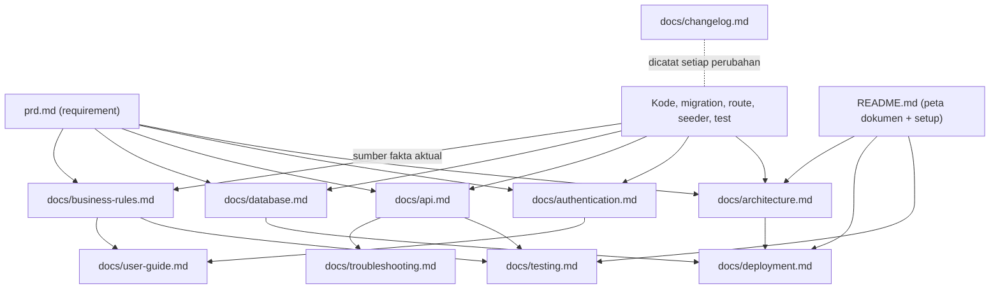

### 19.5 Standar penamaan, format, dan bahasa

| Aspek | Standar |
|---|---|
| Nama file | `kebab-case.md` huruf kecil; pengecualian konvensional: `README.md`, `CONTRIBUTING.md` |
| Struktur | Tepat satu `# H1` per file; hierarki heading berurutan (tidak melompat); maksimal 4 level |
| Header metadata | Setiap dokumen di `docs/` diawali tabel metadata (template di bawah) |
| Bahasa | Indonesia untuk narasi; istilah teknis, nama tabel/kolom/route/field/kode error tetap Inggris dan ditulis dalam `backticks` |
| Tanggal | ISO 8601 (`YYYY-MM-DD`) pada dokumen teknis |
| Kode dan perintah | Code fence dengan penanda bahasa (`bash`, `php`, `json`, `sql`, `mermaid`); perintah harus dapat disalin-jalankan |
| Diagram | Mermaid (versi-able di Git); gambar hanya bila Mermaid tidak memadai |
| Tabel | Untuk data terstruktur (endpoint, kolom, aturan); narasi untuk penjelasan |
| Tautan | Relatif terhadap repositori; tautkan ke ID (`FR-STO-03`, `BR-13`) alih-alih menyalin isi |
| Placeholder | `<NAMA_PLACEHOLDER>`; contoh email memakai domain `example.com`; contoh password **tidak ditulis** (gunakan `<password>`) |
| Screenshot | Tanpa data riil; ditempatkan di `docs/assets/`; diberi teks alternatif |

Template header:

```markdown
# Judul Dokumen

| Atribut | Nilai |
|---|---|
| Tujuan | satu kalimat |
| Cakupan | apa yang dibahas dan tidak dibahas |
| Audiens | developer / QA / admin / pengguna |
| Status | [BELUM DIIMPLEMENTASI] / [SUDAH DIIMPLEMENTASI] / [DEPRECATED] |
| Versi aplikasi | 1.0.0 |
| Terakhir diperbarui | YYYY-MM-DD |
| Pemilik | peran |
| Terkait | prd.md §…, FR-…, BR-…, docs/… |
```

### 19.6 Standar isi minimum per dokumen

| Dokumen | Bagian wajib |
|---|---|
| **README.md** | Deskripsi singkat; fitur (MVP vs direncanakan, berlabel); tech stack dan versi; prasyarat; langkah instalasi dan setup (clone → `composer install` → `npm ci` → salin `.env.example` → `php artisan key:generate` → atur DB → `php artisan migrate --seed` → `php artisan storage:link` → `npm run dev`); konfigurasi environment (tautan `.env.example`); cara menjalankan; cara membuat Super Admin awal (tanpa credential); cara menjalankan test dan lint; struktur proyek ringkas; **peta dokumentasi** (tabel tautan); kontribusi dan kontak |
| **architecture.md** | Gambaran sistem + diagram; lapisan dan tanggung jawab; alur request; komponen dan komunikasi; alur posting stok (sequence); konkurensi dan locking; error handling dan logging; storage, scheduler; keputusan arsitektural (tautan ADR); batasan dan jalur pengembangan |
| **database.md** | ERD; per tabel (kolom, tipe, constraint, keterangan); relasi dan aturan FK; index dan alasannya; CHECK/invarian; konvensi penamaan; strategi migration (urutan, expand/contract, rollback); seeder; query rekonsiliasi; retensi data |
| **api.md** | Konvensi (auth, CSRF, negosiasi, format, pagination); tabel route (method, path, permission, peran); request dan response per operasi inti dan AJAX; validasi per endpoint; **katalog kode error**; rate limit; catatan perubahan kontrak |
| **authentication.md** | Alur login/logout; konfigurasi sesi; kebijakan password; throttle; `must_change_password`; aktivasi/nonaktif; **matriks peran-izin**; Policy dan scope own; CSRF dan header keamanan; audit log autentikasi; cara menambah peran/izin; prosedur Super Admin awal |
| **business-rules.md** | Tabel BR (ID, aturan, lokasi penegakan di kode, TC); status dan transisi + diagram; algoritma posting; rumus (status stok, selisih); penomoran; edge case |
| **user-guide.md** | Per peran: login dan ganti password; navigasi; tugas umum langkah demi langkah (tambah barang, catat barang masuk/keluar, konfirmasi, pembatalan, penyesuaian, membaca notifikasi/stok minimum, laporan dan ekspor, kelola pengguna); FAQ; arti pesan error umum |
| **deployment.md** | Lingkungan; kebutuhan server; variabel lingkungan (nama saja); build; prosedur rilis; migrasi; rollback; backup dan restore **beserta catatan uji restore terakhir**; scheduler; hardening checklist; monitoring |
| **testing.md** | Strategi; setup lingkungan uji (MySQL); perintah; struktur dan konvensi nama test (`TC-…`); test data/factory; pengujian konkurensi; skenario UAT dan hasilnya; target cakupan; pipeline CI; pemetaan AC → TC |
| **troubleshooting.md** | Tabel *Gejala → Kemungkinan penyebab → Diagnosis → Solusi → Pencegahan*. Entri awal wajib: login 429/419; stok "tidak cukup" padahal terlihat ada; `LOCK_TIMEOUT`; rekonsiliasi menemukan selisih; ekspor gagal/melebihi batas; foto tidak tampil (`storage:link`); 500 dengan ID korelasi; migrasi gagal; tanggal/jam salah (timezone) |
| **changelog.md** | Format *Keep a Changelog*, versi SemVer; bagian `Unreleased`; kategori `Added`, `Changed`, `Deprecated`, `Removed`, `Fixed`, `Security`, ditambah `Behavior`, `Schema`, `Architecture` untuk perubahan yang memengaruhi dokumen teknis; setiap entri menyebut ID terkait (FR/BR/D-/PR) |

### 19.7 Penyusunan dokumentasi per fase pengembangan

| Fase (§18.3) | Dokumen yang dibuat/diperbarui | Status label saat selesai fase |
|---|---|---|
| 0 | README (setup), CONTRIBUTING, PR template, `.env.example`, kerangka `docs/` dengan header | README `[SUDAH DIIMPLEMENTASI]`; lainnya kerangka |
| 1 | `database.md` (dari migration aktual), `architecture.md` bagian struktur | `database.md` ✔ |
| 2 | `authentication.md`, `api.md` (route auth/pengguna) | ✔ untuk bagian yang sudah ada kode |
| 3 | `api.md`, `business-rules.md` (master data), `user-guide.md` (master) | per modul |
| 4 | `business-rules.md` (stok), `architecture.md` (posting, locking), `api.md`, `testing.md` (konkurensi), `troubleshooting.md` awal | Inti stok |
| 5–6 | `api.md`, `user-guide.md` (dashboard, laporan, log), `testing.md` | per modul |
| 7 | `deployment.md` final, `troubleshooting.md` final, `user-guide.md` final, `changelog.md` rilis 1.0.0, pemeriksaan DOC-AC | Seluruhnya diverifikasi |

Bagian dokumen yang menjelaskan fitur yang belum ada wajib berlabel `[DIRENCANAKAN]` dan tidak ditulis seolah sudah berfungsi.

### 19.8 Pemicu pembaruan dokumentasi

| Jenis perubahan | Dokumen yang **wajib** diperbarui dalam PR yang sama |
|---|---|
| Fitur baru / perubahan perilaku | `business-rules.md`, `user-guide.md`, `api.md` (bila ada endpoint), `testing.md` (TC), `changelog.md`; `prd.md` bila requirement berubah |
| Aturan bisnis / status / transisi | `business-rules.md`, `prd.md` (§6–7), `testing.md`, `user-guide.md`, `changelog.md` |
| Migration / skema | `database.md`, `changelog.md` (`Schema`); `architecture.md` bila struktur berubah; `deployment.md` bila butuh langkah khusus |
| Endpoint, validasi, respons, kode error | `api.md`, `testing.md`, `troubleshooting.md` (bila relevan), `changelog.md` |
| Peran / izin | `authentication.md` (matriks), `user-guide.md`, `api.md` (kolom peran), seeder dan dataset TC-AUTHZ, `changelog.md` |
| Env / konfigurasi / dependensi | `.env.example`, `README.md`, `deployment.md`, `changelog.md` |
| Arsitektur / komponen | `architecture.md`, ADR bila menyimpang dari PRD, `README.md` (struktur), `changelog.md` (`Architecture`) |
| Proses deploy / backup | `deployment.md`, `troubleshooting.md`, `changelog.md` |
| Perbaikan bug perilaku | `changelog.md`, TC regresi di `testing.md`, `troubleshooting.md` bila ada workaround |
| Perubahan UI / alur pengguna | `user-guide.md` (termasuk screenshot), `changelog.md` |

### 19.9 Definition of Done (DoD)

**Per perubahan (PR):**

- [ ] AC terkait terpenuhi; TC ditulis dan lulus; CI hijau (Pint, Larastan, Pest, build aset).
- [ ] Otorisasi diuji untuk setiap endpoint baru/diubah (semua peran).
- [ ] Migration diuji pada database kosong dan pada database dari rilis sebelumnya.
- [ ] **Dokumentasi terkait diperbarui sesuai §19.8** dan label status benar.
- [ ] Entri `docs/changelog.md` ditambahkan (dengan ID FR/BR/PR).
- [ ] `prd.md` dan matriks traceability (§20) diperbarui bila ada requirement/ID baru atau berubah.
- [ ] Tidak ada credential/secret di kode, dokumen, atau screenshot; secret scan lulus.
- [ ] Perubahan UI: diperiksa keyboard, kontras, responsif (NFR-UI).
- [ ] Minimal satu reviewer menyetujui, termasuk memeriksa checklist dokumentasi.

**Per rilis:**

- [ ] Seluruh TC otomatis lulus; UAT lulus; tidak ada defect kritis/tinggi terbuka.
- [ ] DOC-AC-01 s.d. DOC-AC-16 terverifikasi (atau pengecualian dicatat).
- [ ] Prosedur rilis §17.4 dan smoke test dijalankan di staging.
- [ ] `changelog.md` memuat rilis; tag SemVer dibuat.

### 19.10 Acceptance criteria dokumentasi

| ID | Terkait | Kriteria yang dapat diverifikasi |
|---|---|---|
| DOC-AC-01 | DOC-01 | Developer baru yang tidak menulis README, hanya mengikuti README, dapat menjalankan aplikasi hingga halaman login tampil dan test lulus dalam ≤ 60 menit (diuji setiap rilis minor) |
| DOC-AC-02 | DOC-01, 08, 09 | Setiap perintah di README, `deployment.md`, `testing.md` dapat dieksekusi tanpa modifikasi pada lingkungan sesuai prasyarat |
| DOC-AC-03 | DOC-02 | Komponen, service, dan alur di `architecture.md` sesuai struktur folder dan service aktual (checklist PR yang menambah komponen) |
| DOC-AC-04 | DOC-03 | Tabel/kolom/index di `database.md` sama dengan hasil `migrate:fresh` (dibandingkan dengan `SHOW CREATE TABLE`/`db:show`) pada setiap PR berisi migration |
| DOC-AC-05 | DOC-04 | Setiap route aplikasi pada `php artisan route:list` ada di `api.md` dan sebaliknya; kolom permission/peran sesuai Policy |
| DOC-AC-06 | DOC-05 | Matriks izin di `authentication.md` = seeder izin = dataset TC-AUTHZ-01 (satu dataset dipakai bersama) |
| DOC-AC-07 | DOC-06 | Setiap BR di `business-rules.md` menunjuk lokasi penegakan di kode dan ≥ 1 TC |
| DOC-AC-08 | DOC-08 | Prosedur rilis dan rollback pernah dijalankan penuh di staging sebelum produksi; catatan uji restore terbaru ≤ 31 hari |
| DOC-AC-09 | DOC-09 | Daftar TC sesuai matriks traceability; hasil UAT terakhir tercatat |
| DOC-AC-10 | DOC-07 | Tiap fitur MVP per peran memiliki langkah; QA mengikuti panduan di staging tanpa bantuan pada setiap rilis minor |
| DOC-AC-11 | DOC-10 | Setiap kode error di `api.md` memiliki entri atau tautan penjelasan di `troubleshooting.md` |
| DOC-AC-12 | DOC-11 | Setiap rilis memiliki entri; tidak ada perubahan perilaku/skema/arsitektur tanpa entri |
| DOC-AC-13 | semua | Secret scan (mis. gitleaks) pada repositori lulus; contoh memakai placeholder |
| DOC-AC-14 | semua | Seluruh tautan relatif valid (link checker di CI) |
| DOC-AC-15 | semua | Tidak ada fitur berlabel `[SUDAH DIIMPLEMENTASI]` tanpa kode dan test yang sudah di-merge |
| DOC-AC-16 | semua | Tidak ada fakta yang diduplikasi dengan nilai berbeda; dokumen non-SoT menautkan SoT (diperiksa saat review) |

### 19.11 Pemeliharaan

- Setiap dokumen punya **pemilik** (kolom §19.2) yang bertanggung jawab atas akurasi.
- Audit dokumentasi pada setiap rilis minor dan minimal satu kali per kuartal: jalankan DOC-AC, hapus atau tandai `[DEPRECATED]` (dengan tanggal dan pengganti) dokumen yang usang; jangan biarkan dokumen kedaluwarsa tanpa label.
- ADR bersifat tidak berubah setelah diterima; perubahan keputusan = ADR baru yang *menggantikan* yang lama.
- Pemeriksaan otomatis yang direkomendasikan di CI: markdown lint, link checker, secret scan, dan (opsional) skrip pembanding `route:list` vs `api.md`.

---

## 20. Matriks Traceability

| Modul / topik | Requirement | Aturan bisnis | Acceptance criteria | Test case | Dokumentasi terkait |
|---|---|---|---|---|---|
| Autentikasi | FR-AUTH-01..10 | BR-24, BR-30, BR-32 | AC-AUTH-01..06 | TC-AUTH-01..06, TC-SEC-01, TC-SEC-02 | authentication, user-guide, api, troubleshooting |
| Pengguna & peran | FR-USR-01..06 | BR-03, BR-24 | AC-USR-01..04 | TC-USR-01..03, TC-AUTHZ-01, 05 | authentication, user-guide, api |
| Dashboard | FR-DSH-01..06 | BR-18, BR-21, BR-27 | AC-DSH-01..04 | TC-DSH-01..04 | user-guide, api, business-rules |
| Kategori | FR-CAT-01..04 | BR-03, BR-04 | AC-CAT-01..03 | TC-CAT-01..03 | business-rules, user-guide, api, database |
| Satuan | FR-UNT-01..04 | BR-01, BR-04, BR-25 | AC-UNT-01..02 | TC-UNT-01..02 | business-rules, user-guide, api, database |
| Supplier | FR-SUP-01..05 | BR-03, BR-05, BR-19, BR-22 | AC-SUP-01..03 | TC-SUP-01..03 | business-rules, user-guide, api, database |
| Barang | FR-PRD-01..06 | BR-01..06, BR-17, BR-25, BR-26 | AC-PRD-01..09 | TC-PRD-01..07, TC-SEC-05, TC-AUTHZ-04 | business-rules, user-guide, api, database |
| Barang masuk | FR-STI-01..07 | BR-07..09, BR-11..14, BR-19..23 | AC-STI-01..12 | TC-STI-01..10, TC-CON-01 | business-rules, architecture, api, user-guide, database |
| Barang keluar | FR-STO-01..07 | BR-07..14, BR-19, BR-20, BR-23 | AC-STO-01..08 | TC-STO-01..07, TC-CON-02 | business-rules, architecture, api, user-guide, database |
| Penyesuaian | FR-ADJ-01..02 | BR-08, BR-09, BR-16, BR-20 | AC-ADJ-01..06 | TC-ADJ-01..04, TC-CON-03 | business-rules, api, user-guide, database |
| Stok, minimum, riwayat, notifikasi | FR-STK-01..04, FR-NTF-01 | BR-15, BR-18, BR-29 | AC-STK-01..06 | TC-STK-01..05 | business-rules, user-guide, api |
| Laporan & ekspor | FR-RPT-01..05, FR-EXP-01..04 | BR-21, BR-27, BR-31 | AC-RPT-01..08 | TC-RPT-01..06, TC-SEC-06 | api, user-guide, business-rules |
| Log aktivitas | FR-LOG-01..03 | BR-15, BR-30 | AC-LOG-01..03 | TC-LOG-01..02, TC-STK-03 | authentication, user-guide, database |
| Pengaturan & rekonsiliasi | FR-SET-01..02, FR-SYS-01 | BR-20, BR-28, BR-32 | AC-SYS-01..03 | TC-SYS-01..03 | deployment, troubleshooting, business-rules |
| UI/UX & aksesibilitas | NFR-UI-01..07 | — | AC-UI-01..04 | TC-UI-01..04 | user-guide, README |
| Keamanan | SEC-01..17 | — | (lihat kolom verifikasi §14.1) | TC-SEC-01..06, TC-ERR-01..05, TC-AUTHZ-* | authentication, deployment |
| Performa, keandalan | NFR-PERF, NFR-REL, NFR-OBS | — | (target §14.3–14.4) | uji staging | deployment, testing, architecture |
| Dokumentasi | DOC-01..15 | — | DOC-AC-01..16 | pemeriksaan §19.10 | seluruh `docs/` |

---

## 21. Hasil Pemeriksaan Konsistensi

Pemeriksaan di bawah dilakukan **atas isi PRD ini** (konsistensi internal). Proyek belum diimplementasikan sehingga tidak ada klaim bahwa kode, migration, API, atau dokumentasi aktual telah diverifikasi.

| # | Pemeriksaan | Hasil |
|---|---|---|
| 1 | Matriks izin §4.2 = menu §13.1 = route §12.2 = FR per modul = AC | Konsisten. Titik rawan yang sudah diputuskan: SG hanya lihat master + scope own (D-05, D-06, D-25); MG hanya baca (§4.2) |
| 2 | Status dan transisi §7 = FR-STI/STO = BR-07/12/13/14 = alur §8 = kode error §15 | Konsisten; transisi tidak sah selalu `INVALID_STATE_TRANSITION` |
| 3 | Setiap field di FR memiliki kolom di skema §11 (mis. `source_type`, `purpose_type`, `destination`, `reason_code`, `cancel_reason`, `allow_decimal`, `must_change_password`, `expected_system_qty` → tidak disimpan, hanya dipakai validasi) | Konsisten |
| 4 | Invarian BR dipertahankan juga oleh constraint DB (CHECK stok ≥ 0, quantity > 0, UNIQUE per dokumen, `qty_after = before + change`) | Konsisten |
| 5 | Setiap BR memiliki ≥ 1 AC dan TC (§20) | Terpenuhi (BR-02, 06, 14, 29, 32 dilengkapi AC-PRD-08, AC-PRD-09, AC-STI-12/AC-STO-08, AC-STK-06, AC-SYS-03) |
| 6 | Setiap kode error §15 muncul pada FR/AC dan kontrak §12 | Konsisten |
| 7 | Tidak ada total kuantitas lintas satuan di dashboard, laporan, grafik | Konsisten (D-01, D-02, BR-27) |
| 8 | Semua jalur perubahan stok memakai locking, transaksi, movement, log | Konsisten (BR-08/09; §6.2) |
| 9 | Fitur multi-gudang tidak muncul pada skema/menu/enum MVP | Konsisten (D-09, A-01) |
| 10 | Tech stack §10 sesuai sumber (Laravel 12, PHP 8.2.29, MySQL 8.0.30, Tailwind, Laragon) dengan catatan risiko versi (R-01) | Konsisten; R-01 perlu keputusan sebelum produksi |
| 11 | Roadmap §18.3 menempatkan `ActivityLogger` sebelum transaksi (D-29) dan dokumentasi §19.7 mengikuti fase | Konsisten |
| 12 | Standar dokumentasi §19 mencakup seluruh dokumen yang diminta + tambahan yang diperlukan, dengan SoT tunggal | Konsisten |

**Konflik logika yang diketahui dan belum terselesaikan:** tidak ada. Hal yang masih bergantung pada keputusan stakeholder tercatat sebagai Q-01..Q-06 dan sudah memiliki default yang tidak memblokir pengembangan.

**Yang harus diverifikasi saat implementasi** (belum terverifikasi sekarang): kompatibilitas versi pustaka dengan Laravel 12 dan PHP 8.2; perilaku locking dan CHECK pada versi MySQL produksi; target performa §14.3 pada data uji besar; kesesuaian setiap dokumen `docs/` dengan implementasi (DOC-AC).

---

## 22. Lampiran

### Lampiran A — Katalog aksi log aktivitas

| Kelompok | Aksi (`activity_logs.action`) |
|---|---|
| Autentikasi | `auth.login`, `auth.login_failed`, `auth.logout`, `auth.password_changed` |
| Pengguna | `user.created`, `user.updated`, `user.status_changed`, `user.role_changed`, `user.password_reset` |
| Master data | `category.created\|updated\|status_changed`, `unit.…`, `supplier.…`, `product.created\|updated\|status_changed\|photo_changed` |
| Barang masuk | `stock_in.draft_created`, `stock_in.draft_updated`, `stock_in.confirmed`, `stock_in.draft_cancelled`, `stock_in.cancelled` |
| Barang keluar | `stock_out.draft_created`, `stock_out.draft_updated`, `stock_out.confirmed`, `stock_out.draft_cancelled`, `stock_out.cancelled` |
| Penyesuaian | `adjustment.created` |
| Lain-lain | `settings.updated`, `report.exported`, `system.reconcile` |

`old_values`/`new_values` disimpan untuk perubahan master data, peran, status, pengaturan; ringkasan stok sebelum/sesudah untuk transaksi dan penyesuaian. Tidak pernah menyimpan password atau token.

### Lampiran B — Data seed awal

| Data | Isi |
|---|---|
| Peran | `super_admin`, `admin_gudang`, `staff_gudang`, `manajer` + izin sesuai §4.2 |
| Satuan | pcs, unit, box, karton, pack (bulat); kilogram, gram, liter, meter (desimal) |
| Pengaturan | `company_name = "Nama Perusahaan"`, `max_backdate_days = 7` |
| Super Admin awal | Email dari `INITIAL_ADMIN_EMAIL`; password acak sekali pakai (tidak disimpan di berkas); wajib ganti saat login pertama |
| Demo (hanya local/testing) | Kategori contoh (Elektronik, Peralatan Kantor, Bahan Baku, Makanan dan Minuman, Perlengkapan Kebersihan, Suku Cadang), beberapa barang dan supplier fiktif |

### Lampiran C — Template entri changelog

```markdown
## [Unreleased]

### Added
- Barang keluar: konfirmasi dengan row locking (FR-STO-03, BR-08, BR-09). PR #123

### Changed
- ...

### Behavior
- Pembatalan barang masuk kini ditolak bila stok tidak cukup (BR-13).

### Schema
- Migration `2026_11_20_000000_add_cancel_reason_to_stock_ins_table`.
```

### Lampiran D — Template checklist PR (`.github/pull_request_template.md`)

```markdown
## Ringkasan
<!-- Apa dan mengapa; ID terkait: FR-..., BR-..., AC-... -->

## Checklist
- [ ] Test ditulis/diperbarui dan lulus (Pest); Pint dan Larastan bersih
- [ ] Otorisasi diuji untuk semua peran
- [ ] Migration diuji (fresh + upgrade)
- [ ] Dokumentasi diperbarui sesuai PRD §19.8: README / architecture / database / api / authentication / business-rules / user-guide / deployment / testing / troubleshooting
- [ ] `docs/changelog.md` diperbarui
- [ ] `prd.md` dan traceability diperbarui bila requirement berubah
- [ ] Tidak ada credential/secret/data riil
- [ ] (UI) keyboard, kontras, responsif diperiksa
```

### Lampiran E — Riwayat revisi PRD

| Versi | Tanggal | Perubahan | Disetujui oleh |
|---|---|---|---|
| 1.0.0-draft | 2026-11-06 | Penyusunan awal dari deskripsi produk; keputusan D-01..D-35, asumsi A-01..A-15 | *(menunggu persetujuan stakeholder)* |
